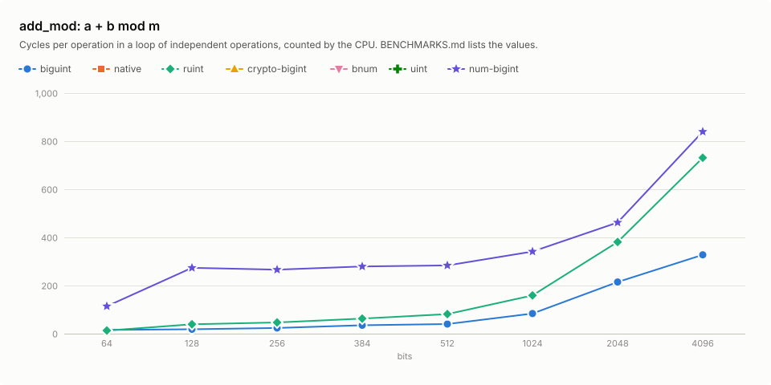
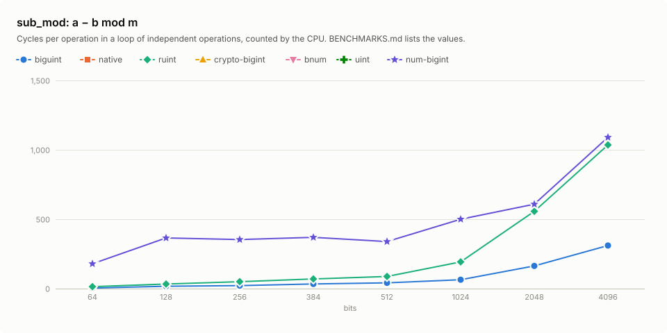

# Benchmarks

`biguint` at commit `1069a8e` against `native`, `ruint`, `crypto-bigint`, `bnum`, `uint` and `num-bigint`: add, mul, div, mod, mulmod, add_mod and sub_mod at 64, 128, 256, 384, 512, 1024, 2048 and 4096 bits, in cycles and instructions per operation, measured on 2026-11-02.

The CPU is an AMD Ryzen 9 5950X 16-Core Processor, measured on its CPU 15.
Its counters give each figure per operation as the median, over 31 repetitions, of a run of 2n operations on fresh operands less a run of n, over n.

## Setup

|  |  |
|---|---|
| CPU | AMD Ryzen 9 5950X 16-Core Processor (`znver3`) |
| Compiler | rustc 1.99.1 (58cf8f9c3 2026-10-13), LLVM 23.1.1, `bench` profile |
| Features | `biguint` with its default features |
| RUSTFLAGS | `-C target-cpu=native -C codegen-units=1` |
| Extensions | adx, aes, avx, avx2, bmi1, bmi2, f16c, fma, lzcnt, movbe, pclmulqdq, popcnt, sha, sse, sse2, sse3, sse4.1, sse4.2, sse4a, ssse3, vaes, vpclmulqdq |
| Counters | one Linux perf_event group: user-mode cycles, instructions and branch misses |
| Load | 1-minute load average 19.91 before the sweep and 17.7 after; CPU 31, the SMT sibling of CPU 15, busy 6% of the sweep |
| Crates | ruint 1.21.1, crypto-bigint 0.7.10, bnum 0.14.4, uint 0.10.2, num-bigint 0.5.1 |

## Method

A sweep measures every case in 31 repetitions; repetition r of every case runs before repetition r + 1 of any case, so a drift of the machine reaches all cases alike. Each run draws fresh operand sets from the case's distribution, outside the counted region: no operand set runs twice, so the branch predictor never learns a sequence. A repetition runs n operations uncounted, then counts a run of n operations and a run of 2n. Before the repetitions, n starts at 16 operations and doubles until a run of n, counted after an uncounted run of as many, takes 1,048,576 cycles; n stops earlier where the operand sets of 2n operations fill 256 KiB.

One perf_event group on the measuring thread, pinned to one CPU, counts user-mode cycles, instructions and branch misses; a run during which the kernel shares the counters with other groups stops the sweep. A figure per operation is the median, over the 31 repetitions, of the long run less the short run, divided by n: the fixed cost of a run cancels, as in nanoBench's differencing, and each difference pairs two runs taken back to back. A case whose long runs count no more cycles than its short runs stops the sweep, and so does a chain step under one cycle, the latency of a single instruction.

Throughput runs independent operations, with operands and results behind `core::hint::black_box`. Latency runs the chain `x = op(x, y)`: from the second operand set on, each result is the first operand of the next operation, so each operation waits for the one before. Each result passes through an empty inline-assembly block, which keeps the compiler from regrouping the chain. The block holds a result of up to 64 bytes in general-purpose registers in one chain and in vector registers in another, each chain a case of its own in the sweep; it can only add moves between the two, so the latency is the chain with fewer cycles. A larger result passes through memory, in a single chain. The chain applies where the result has the type of the first operand and the other operands are plain values: a step copies them, and the copy of an allocated value would allocate.

The sweep ran at a 1-minute load of 2 or more, so its cycles compare within each table only.

Before a case is measured, its results on 256 operand sets equal `num-bigint`'s, reduced modulo 2^N for the crates that wrap. The functions that a case calls, such as the allocator of `num-bigint`, are part of its counts.

The chains are those of add, of the native mul, whose hardware multiply takes the same time on all operands, and of the modular functions that return the type of their operands and reduce any operand: each step of such a chain has its own modulus, below which the result of the step before may not lie. A chain of products modulo 2^N gathers trailing zeros and a chain of quotients falls to zero, so the other cases of mul, div and mod have no chain; `crypto-bigint`'s add_mod and sub_mod need operands below the modulus, `biguint`'s mulmod returns an `Option`, and a step of `num-bigint` would copy allocated operands.

| Operation | Operands at width N |
|---|---|
| add, mul | `a` and `b` uniform below 2^N |
| div, mod | a dividend with bit N − 1 set; a divisor below 2^(N/2) with bit N/2 − 1 set, held in an N-bit integer |
| mulmod, add_mod, sub_mod | a modulus `m` with bit N − 1 set; `a` and `b` uniform below `m` |

## Functions

Each cell measures the crate's own function:

| Operation | biguint | native | ruint | crypto-bigint | bnum | uint | num-bigint |
|---|---|---|---|---|---|---|---|
| add | `+` | `wrapping_add` at 64 and 128 bits | `wrapping_add` | `wrapping_add` | `wrapping_add` | `overflowing_add` at 64 bits | – |
| mul | `*` | `wrapping_mul` at 64 and 128 bits | `wrapping_mul` at 64, 128, 256, 384, 512, 2048 and 4096 bits | `wrapping_mul` at 64, 128, 256, 384, 512 and 1024 bits | `wrapping_mul` at 64, 128, 256, 384, 512 and 1024 bits | `overflowing_mul` at 64, 128, 256, 384 and 1024 bits | `&a * &b` at 2048 and 4096 bits |
| div | `div_rem` | `/ NonZero` at 64 and 128 bits | `wrapping_div` | `wrapping_div_vartime` | `wrapping_div` | `/` | `&a / &b` |
| mod | `div_rem` | `% NonZero` at 64 and 128 bits | `wrapping_rem` | `rem_vartime` | `wrapping_rem` | `%` | `&a % &b` |
| mulmod | `mul_mod` | – | `mul_mod` | `mul_mod_vartime` | – | – | – |
| add_mod | `add_mod` | – | `add_mod` | – | – | – | `(&a + &b) % &m` |
| sub_mod | `sub_mod` | – | `a.add_mod(m - b.reduce_mod(m), m)` | – | – | – | `(&a + &m - &b) % &m` |

- Each row compares functions of one timing class, the class of `biguint`'s function: add, and mul up to 1024 bits, take a time that the width fixes; mul from 2048 bits, div, mod, mulmod, add_mod and sub_mod take a time that depends on the values.
- `native` is `u64` at 64 bits and `u128` at 128 bits.
- `crypto-bigint` is constant-time; its div, mod and mulmod cases run its `*_vartime` functions.
- `num-bigint` allocates each result.
- `uint` is `construct_uint!`, as in `primitive-types`.
- No primitive of this width: `native` at 256, 384, 512, 1024, 2048 and 4096 bits.
- No modular product: `native` mulmod at 64 and 128 bits, `bnum` mulmod, `uint` mulmod and `num-bigint` mulmod.
- No modular sum or difference: `native` add_mod and sub_mod at 64 and 128 bits, `bnum` add_mod and sub_mod and `uint` add_mod and sub_mod.
- Variable time in a fixed-time row: `ruint` mul at 1024 bits, `uint` add at 128, 256, 384, 512, 1024, 2048 and 4096 bits and mul at 512 bits and `num-bigint` add and mul at 64, 128, 256, 384, 512 and 1024 bits.
- Fixed time in a variable-time row: `crypto-bigint` mul at 2048 and 4096 bits, add_mod and sub_mod, `bnum` mul at 2048 and 4096 bits and `uint` mul at 2048 and 4096 bits.

## Results

### add: a + b


Each cell: throughput cycles / latency cycles / instructions per operation. Bold: the fewest of the row. –: no such function or no chain form.

| Bits | biguint | native | ruint | crypto-bigint | bnum | uint | num-bigint |
|---|---:|---:|---:|---:|---:|---:|---:|
| 64 | 2.2 / **1.3** / **8.0** | 2.2 / 1.3 / **8.0** | 2.2 / 1.3 / **8.0** | **2.2** / 2.0 / **8.0** | 2.2 / 1.3 / **8.0** | 2.2 / 1.3 / **8.0** | – |
| 128 | 3.3 / **2.0** / **11.0** | 3.2 / 2.0 / **11.0** | 3.3 / 2.0 / **11.0** | **3.2** / 2.0 / **11.0** | 3.3 / 2.1 / **11.0** | – | – |
| 256 | 5.7 / 3.3 / **17.0** | – | **5.6** / **3.3** / **17.0** | 6.0 / 5.3 / 22.0 | 5.7 / 3.3 / 19.0 | – | – |
| 384 | 8.3 / 4.1 / **23.0** | – | **8.0** / **4.1** / **23.0** | 9.6 / 10.5 / 32.0 | 8.3 / 5.4 / 31.0 | – | – |
| 512 | 10.9 / 5.7 / **29.0** | – | **10.2** / **5.7** / **29.0** | 12.4 / 16.5 / 42.0 | 11.7 / 7.9 / 43.0 | – | – |
| 1024 | 25.9 / 40.2 / 70.0 | – | **23.1** / 40.1 / **63.0** | 29.1 / **39.7** / 92.0 | 29.3 / 39.7 / 103 | – | – |
| 2048 | **59.4** / **75.8** / **143** | – | 83.2 / 103 / 164 | 79.6 / 115 / 208 | 96.6 / 104 / 268 | – | – |
| 4096 | **163** / **220** / 484 | – | 173 / 238 / 468 | 204 / 323 / **459** | 211 / 315 / 596 | – | – |

### mul: a × b


Each cell: throughput cycles / latency cycles / instructions per operation. Bold: the fewest of the row. –: no such function or no chain form.

| Bits | biguint | native | ruint | crypto-bigint | bnum | uint | num-bigint |
|---|---:|---:|---:|---:|---:|---:|---:|
| 64 | 2.3 / – / **8.0** | 2.2 / **3.0** / **8.0** | 2.3 / – / **8.0** | **2.2** / – / **8.0** | 2.2 / – / **8.0** | 2.3 / – / **8.0** | – |
| 128 | 3.8 / – / **14.0** | 3.7 / **5.0** / 16.0 | **3.3** / – / **14.0** | 3.3 / – / **14.0** | 3.6 / – / 16.0 | 3.3 / – / **14.0** | – |
| 256 | 13.0 / – / 46.0 | – | **12.7** / – / **44.0** | 13.0 / – / 46.0 | 16.0 / – / 51.0 | 16.0 / – / 57.0 | – |
| 384 | **29.3** / – / 103 | – | 30.9 / – / **94.0** | 30.5 / – / 114 | 33.0 / – / 128 | 37.9 / – / 145 | – |
| 512 | **54.9** / – / 192 | – | 59.6 / – / **172** | 96.5 / – / 346 | 77.8 / – / 273 | – | – |
| 1024 | **228** / – / **795** | – | – | 390 / – / 1,370 | 393 / – / 1,259 | 438 / – / 1,449 | – |
| 2048 | **1,166** / – / **3,565** | – | 1,611 / – / 4,390 | – | – | – | 3,495 / – / 9,748 |
| 4096 | **4,740** / – / **11,678** | – | 6,655 / – / 14,900 | – | – | – | 11,339 / – / 31,564 |

### div: a / b


Each cell: throughput cycles / latency cycles / instructions per operation. Bold: the fewest of the row. –: no such function or no chain form.

| Bits | biguint | native | ruint | crypto-bigint | bnum | uint | num-bigint |
|---|---:|---:|---:|---:|---:|---:|---:|
| 64 | 7.0 / – / **14.0** | **7.0** / – / **14.0** | 7.0 / – / 16.0 | 229 / – / 451 | 7.0 / – / 23.0 | 7.0 / – / 21.0 | 39.5 / – / 143 |
| 128 | 17.3 / – / **26.0** | **16.8** / – / 26.0 | 32.5 / – / 58.5 | 272 / – / 518 | 31.2 / – / 92.0 | 30.6 / – / 91.0 | 113 / – / 341 |
| 256 | 87.0 / – / **171** | – | **82.3** / – / 200 | 544 / – / 1,312 | 246 / – / 545 | 202 / – / 564 | 290 / – / 1,073 |
| 384 | **164** / – / **497** | – | 199 / – / 592 | 707 / – / 1,789 | 363 / – / 776 | 314 / – / 785 | 354 / – / 1,243 |
| 512 | **221** / – / **637** | – | 257 / – / 770 | 844 / – / 2,262 | 492 / – / 1,202 | 397 / – / 1,060 | 420 / – / 1,372 |
| 1024 | **514** / – / **1,347** | – | 593 / – / 1,653 | 1,636 / – / 4,908 | 1,131 / – / 3,149 | 991 / – / 2,377 | 816 / – / 2,277 |
| 2048 | **1,447** / – / **3,431** | – | 1,564 / – / 4,154 | 4,119 / – / 13,654 | 3,403 / – / 7,981 | 3,307 / – / 6,598 | 2,091 / – / 5,220 |
| 4096 | **4,605** / – / **10,661** | – | 4,924 / – / 12,286 | 12,952 / – / 45,588 | 12,618 / – / 29,295 | 12,561 / – / 27,377 | 6,441 / – / 15,030 |

### mod: a mod b


Each cell: throughput cycles / latency cycles / instructions per operation. Bold: the fewest of the row. –: no such function or no chain form.

| Bits | biguint | native | ruint | crypto-bigint | bnum | uint | num-bigint |
|---|---:|---:|---:|---:|---:|---:|---:|
| 64 | **7.0** / – / **14.0** | 7.0 / – / **14.0** | 7.0 / – / 16.0 | 229 / – / 451 | 7.0 / – / 23.0 | 7.0 / – / 21.0 | 8.0 / – / 44.0 |
| 128 | 18.8 / – / 29.0 | **18.1** / – / **29.0** | 31.2 / – / 58.5 | 273 / – / 518 | 33.1 / – / 93.0 | 31.1 / – / 91.0 | 115 / – / 362 |
| 256 | 83.9 / – / **155** | – | **83.8** / – / 202 | 544 / – / 1,312 | 258 / – / 546 | 197 / – / 564 | 303 / – / 1,094 |
| 384 | **175** / – / **477** | – | 191 / – / 572 | 704 / – / 1,789 | 370 / – / 776 | 331 / – / 789 | 359 / – / 1,263 |
| 512 | **226** / – / **603** | – | 230 / – / 747 | 845 / – / 2,262 | 523 / – / 1,202 | 393 / – / 1,060 | 423 / – / 1,393 |
| 1024 | **501** / – / **1,268** | – | 573 / – / 1,596 | 1,634 / – / 4,908 | 1,150 / – / 3,150 | 988 / – / 2,376 | 819 / – / 2,298 |
| 2048 | **1,424** / – / **3,101** | – | 1,538 / – / 4,102 | 4,110 / – / 13,654 | 3,404 / – / 7,980 | 3,287 / – / 6,603 | 2,094 / – / 5,242 |
| 4096 | **4,582** / – / **9,452** | – | 4,921 / – / 12,254 | 12,982 / – / 45,588 | 12,713 / – / 29,292 | 12,629 / – / 27,452 | 6,463 / – / 15,050 |

### mulmod: a × b mod m


Each cell: throughput cycles / latency cycles / instructions per operation. Bold: the fewest of the row. –: no such function or no chain form.

| Bits | biguint | native | ruint | crypto-bigint | bnum | uint | num-bigint |
|---|---:|---:|---:|---:|---:|---:|---:|
| 64 | **12.0** / – / **30.0** | – | 23.5 / **46.6** / 84.0 | 254 / 254 / 496 | – | – | – |
| 128 | **66.5** / – / **149** | – | 86.4 / **88.0** / 192 | 500 / 510 / 935 | – | – | – |
| 256 | 186 / – / 507 | – | **171** / **208** / **439** | 1,001 / 1,001 / 2,297 | – | – | – |
| 384 | **354** / – / 885 | – | 384 / **400** / **829** | 1,469 / 1,480 / 3,783 | – | – | – |
| 512 | 573 / – / 1,359 | – | **526** / **548** / **1,250** | 2,000 / 2,007 / 5,741 | – | – | – |
| 1024 | 1,795 / – / **3,847** | – | **1,552** / **1,564** / 3,930 | 5,312 / 5,351 / 18,246 | – | – | – |
| 2048 | **5,946** / – / **12,717** | – | 7,429 / **7,451** / 16,343 | 16,412 / 16,511 / 63,447 | – | – | – |
| 4096 | **19,903** / – / **39,367** | – | 29,612 / **29,630** / 63,913 | 57,739 / 58,315 / 242,293 | – | – | – |

### add_mod: a + b mod m



Each cell: throughput cycles / latency cycles / instructions per operation. Bold: the fewest of the row. –: no such function or no chain form.

| Bits | biguint | native | ruint | crypto-bigint | bnum | uint | num-bigint |
|---|---:|---:|---:|---:|---:|---:|---:|
| 64 | 15.5 / 15.5 / **19.4** | – | **13.0** / **14.0** / 42.0 | – | – | – | 114 / – / 360 |
| 128 | **18.3** / **21.4** / **31.3** | – | 38.9 / 24.5 / 56.0 | – | – | – | 274 / – / 984 |
| 256 | **23.5** / **29.5** / **43.5** | – | 46.6 / 59.5 / 120 | – | – | – | 266 / – / 1,037 |
| 384 | **34.9** / **44.8** / **65.3** | – | 62.8 / 74.6 / 171 | – | – | – | 279 / – / 1,081 |
| 512 | **40.1** / **46.8** / **96.1** | – | 81.2 / 93.1 / 217 | – | – | – | 284 / – / 1,053 |
| 1024 | **83.6** / **115** / **203** | – | 159 / 193 / 395 | – | – | – | 341 / – / 1,165 |
| 2048 | **215** / **226** / **424** | – | 381 / 461 / 697 | – | – | – | 462 / – / 1,415 |
| 4096 | **328** / **392** / **814** | – | 731 / 818 / 2,021 | – | – | – | 839 / – / 1,887 |

### sub_mod: a − b mod m



Each cell: throughput cycles / latency cycles / instructions per operation. Bold: the fewest of the row. –: no such function or no chain form.

| Bits | biguint | native | ruint | crypto-bigint | bnum | uint | num-bigint |
|---|---:|---:|---:|---:|---:|---:|---:|
| 64 | **4.0** / **6.1** / **19.0** | – | 14.0 / 14.0 / 47.0 | – | – | – | 179 / – / 523 |
| 128 | **16.8** / **20.5** / **30.5** | – | 33.1 / 22.9 / 64.0 | – | – | – | 365 / – / 1,231 |
| 256 | **21.7** / **28.3** / **48.5** | – | 50.1 / 64.4 / 145 | – | – | – | 354 / – / 1,315 |
| 384 | **33.3** / **44.6** / **65.5** | – | 69.4 / 83.2 / 208 | – | – | – | 369 / – / 1,369 |
| 512 | **41.7** / **51.6** / **88.5** | – | 87.3 / 103 / 265 | – | – | – | 339 / – / 1,226 |
| 1024 | **64.0** / **89.2** / **189** | – | 193 / 222 / 545 | – | – | – | 500 / – / 1,621 |
| 2048 | **164** / **328** / **451** | – | 557 / 493 / 976 | – | – | – | 609 / – / 1,840 |
| 4096 | **310** / **376** / **892** | – | 1,035 / 1,110 / 2,680 | – | – | – | 1,090 / – / 2,407 |

## Reproduce

```sh
cargo run -p biguint-bench-report -- bench    # the CPU's counts of the native build
cargo run -p biguint-bench-report -- report   # this file and benchmarks/*.svg
```
