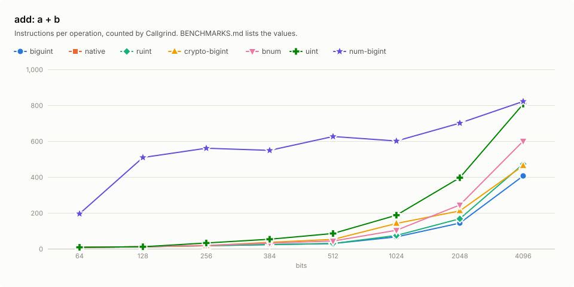
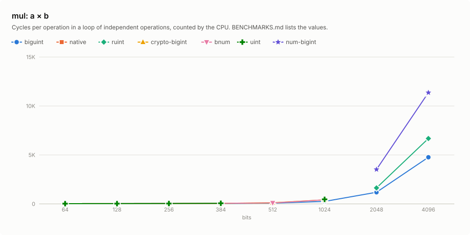
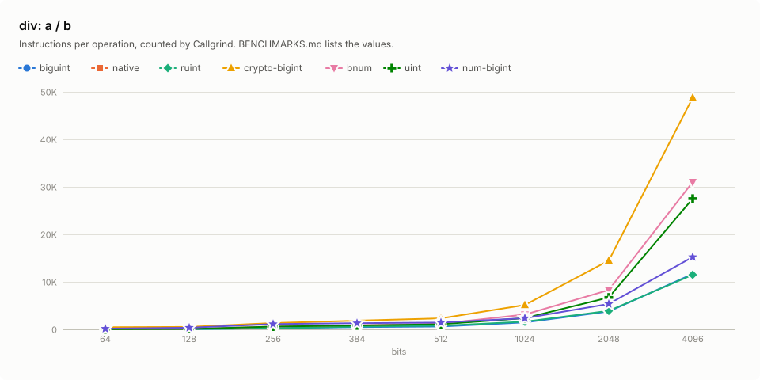
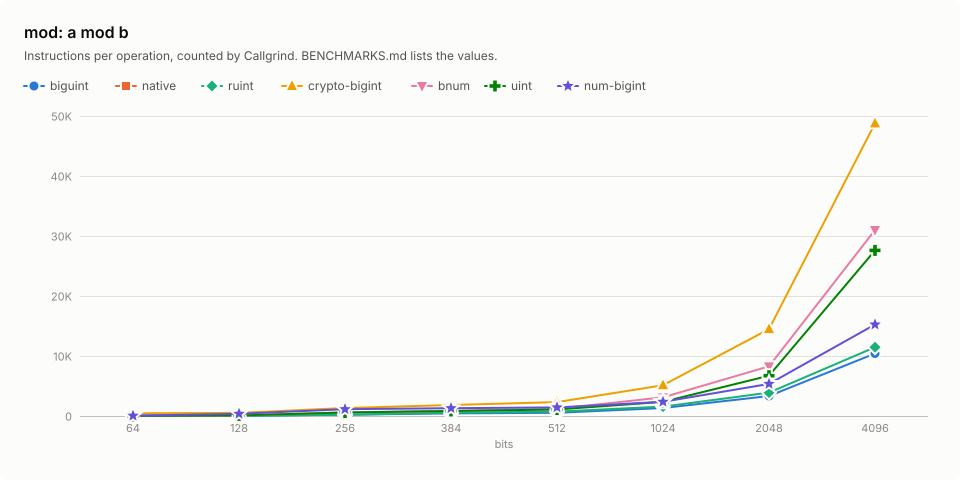
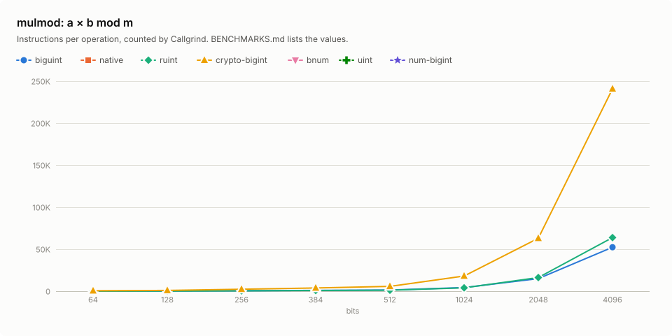

# Benchmarks

`biguint` at commit `13b18eb` against `native`, `ruint`, `crypto-bigint`, `bnum`, `uint` and `num-bigint`: add, mul, div, mod and mulmod at 64, 128, 256, 384, 512, 1024, 2048 and 4096 bits, in instructions per operation, counted on 2026-11-02.

## Setup

|  |  |
|---|---|
| CPU | AMD Ryzen 9 5950X 16-Core Processor (`znver3`) |
| Compiler | rustc 1.99.1 (58cf8f9c3 2026-10-13), LLVM 23.1.1, `bench` profile, `-C target-cpu=native` |
| Counter | Valgrind 3.22.0, Callgrind |
| Crates | ruint 1.21.1, crypto-bigint 0.7.10, bnum 0.14.4, uint 0.10.2, num-bigint 0.5.1 |

## Method

Each case runs one crate's function over 256 operand sets, the same for every crate in a row, with operands and results behind `core::hint::black_box`. Callgrind counts the instructions of the loop over the batch, including the functions it calls, such as the allocator of `num-bigint`; each count is that total divided by 256. The loop's own loads and stores are part of every count. Every instruction counts as one, whatever its latency: a hardware divide weighs as much as an addition. The counts are exact at any machine load. Every result equals `num-bigint`'s, reduced modulo 2^N for the crates that wrap.

| Operation | Operands at width N |
|---|---|
| add, mul | `a` and `b` uniform below 2^N |
| div, mod | a dividend with bit N − 1 set; a divisor below 2^(N/2) with bit N/2 − 1 set, held in an N-bit integer |
| mulmod | a modulus `m` with bit N − 1 set; `a` and `b` uniform below `m` |

## Functions

Each cell counts the crate's own function:

| Operation | biguint | native | ruint | crypto-bigint | bnum | uint | num-bigint |
|---|---|---|---|---|---|---|---|
| add | `+` | `wrapping_add` at 64 and 128 bits | `wrapping_add` | `wrapping_add` | `wrapping_add` | `overflowing_add` | `&a + &b` |
| mul | `*` | `wrapping_mul` at 64 and 128 bits | `wrapping_mul` | `wrapping_mul` | `wrapping_mul` | `overflowing_mul` | `&a * &b` |
| div | `div_rem` | `/ NonZero` at 64 and 128 bits | `wrapping_div` | `wrapping_div_vartime` | `wrapping_div` | `/` | `&a / &b` |
| mod | `div_rem` | `% NonZero` at 64 and 128 bits | `wrapping_rem` | `rem_vartime` | `wrapping_rem` | `%` | `&a % &b` |
| mulmod | `mul_mod` | – | `mul_mod` | `mul_mod_vartime` | – | – | – |

- `native` is `u64` at 64 bits and `u128` at 128 bits.
- `crypto-bigint` is constant-time; its div, mod and mulmod cases run its `*_vartime` functions.
- `num-bigint` allocates each result.
- `uint` is `construct_uint!`, as in `primitive-types`.
- No primitive of this width: `native` at 256, 384, 512, 1024, 2048 and 4096 bits.
- No modular product: `native` mulmod at 64 and 128 bits, `bnum` mulmod, `uint` mulmod and `num-bigint` mulmod.

## Results

Each cell: instructions per operation. Bold marks the fewest in each row.

### add: a + b



| Bits | biguint | native | ruint | crypto-bigint | bnum | uint | num-bigint |
|---:|---:|---:|---:|---:|---:|---:|---:|
| 64 | **8.0** | **8.0** | **8.0** | **8.0** | **8.0** | **8.0** | 195 |
| 128 | **11.0** | **11.0** | **11.0** | **11.0** | **11.0** | **11.0** | 509 |
| 256 | **17.0** | – | **17.0** | **17.0** | 19.0 | 31.9 | 559 |
| 384 | **23.1** | – | **23.1** | 36.1 | 31.1 | 53.1 | 548 |
| 512 | **29.1** | – | **29.1** | 52.1 | 43.1 | 84.9 | 626 |
| 1024 | **66.1** | – | 74.1 | 141 | 103 | 187 | 601 |
| 2048 | **143** | – | 167 | 211 | 244 | 396 | 693 |
| 4096 | **406** | – | 472 | 463 | 600 | 806 | 807 |

### mul: a × b



| Bits | biguint | native | ruint | crypto-bigint | bnum | uint | num-bigint |
|---:|---:|---:|---:|---:|---:|---:|---:|
| 64 | **8.0** | **8.0** | **8.0** | **8.0** | **8.0** | **8.0** | 277 |
| 128 | **14.0** | 16.0 | **14.0** | **14.0** | 16.0 | **14.0** | 613 |
| 256 | **46.1** | – | 47.1 | 47.1 | 51.1 | 57.1 | 778 |
| 384 | **103** | – | 122 | 112 | 128 | 153 | 1,100 |
| 512 | 205 | – | 250 | **191** | 254 | 365 | 1,471 |
| 1024 | **859** | – | 1,496 | 1,341 | 1,255 | 1,209 | 3,325 |
| 2048 | **3,501** | – | 4,406 | 5,489 | 4,369 | 4,960 | 10,129 |
| 4096 | **11,717** | – | 14,786 | 21,391 | 16,511 | 20,146 | 31,749 |

### div: a / b



| Bits | biguint | native | ruint | crypto-bigint | bnum | uint | num-bigint |
|---:|---:|---:|---:|---:|---:|---:|---:|
| 64 | 20.0 | **14.0** | 16.0 | 456 | 23.0 | 21.0 | 145 |
| 128 | 31.1 | **26.1** | 58.6 | 521 | 84.1 | 91.1 | 355 |
| 256 | 214 | – | **201** | 1,332 | 592 | 588 | 1,119 |
| 384 | **432** | – | 578 | 1,826 | 869 | 824 | 1,294 |
| 512 | **541** | – | 761 | 2,323 | 1,193 | 1,078 | 1,426 |
| 1024 | **1,349** | – | 1,614 | 5,125 | 3,117 | 2,361 | 2,349 |
| 2048 | **3,351** | – | 3,904 | 14,475 | 8,284 | 6,715 | 5,346 |
| 4096 | **10,507** | – | 11,487 | 48,761 | 30,995 | 27,523 | 15,231 |

### mod: a mod b



| Bits | biguint | native | ruint | crypto-bigint | bnum | uint | num-bigint |
|---:|---:|---:|---:|---:|---:|---:|---:|
| 64 | 20.0 | **14.0** | 16.0 | 456 | 23.1 | 21.0 | 47.1 |
| 128 | 34.4 | **29.4** | 53.8 | 521 | 84.1 | 92.1 | 369 |
| 256 | 214 | – | **202** | 1,332 | 592 | 589 | 1,130 |
| 384 | **433** | – | 551 | 1,826 | 869 | 829 | 1,306 |
| 512 | **543** | – | 739 | 2,323 | 1,193 | 1,079 | 1,437 |
| 1024 | **1,346** | – | 1,575 | 5,125 | 3,116 | 2,361 | 2,361 |
| 2048 | **3,355** | – | 3,905 | 14,475 | 8,284 | 6,720 | 5,357 |
| 4096 | **10,502** | – | 11,472 | 48,761 | 30,995 | 27,606 | 15,247 |

### mulmod: a × b mod m



| Bits | biguint | native | ruint | crypto-bigint | bnum | uint | num-bigint |
|---:|---:|---:|---:|---:|---:|---:|---:|
| 64 | **30.1** | – | 82.1 | 498 | – | – | – |
| 128 | **188** | – | 190 | 932 | – | – | – |
| 256 | 465 | – | **449** | 2,323 | – | – | – |
| 384 | **787** | – | 801 | 3,844 | – | – | – |
| 512 | **1,177** | – | 1,203 | 5,758 | – | – | – |
| 1024 | **3,384** | – | 4,023 | 18,088 | – | – | – |
| 2048 | **12,727** | – | 16,230 | 62,988 | – | – | – |
| 4096 | **47,569** | – | 63,849 | 240,958 | – | – | – |

## Reproduce

```sh
cargo run -p biguint-bench-report -- bench    # Callgrind counts of the native build
cargo run -p biguint-bench-report -- report   # this file and benchmarks/*.svg
```
