# Benchmarks

`binary-field` at commit `b158fca` against `gf256`, `galois_field_2pm`, `g2p`, `reed-solomon-erasure`, `hekate-math`, `plonky3`, `runtime-algebra`, `compile-algebra`, `core-algebra`, `polyval` and `galois_field_2pm lut`: add, add_vartime, mul, mul_vartime, square, square_vartime, invert, invert_vartime, sqrt and sqrt_vartime over GF(2⁸), GF(2¹⁶), GF(2⁶⁴), GF(2¹²⁸), GF(2²³³), GF(2²⁵⁶) and GF(2⁵⁷¹), in cycles and instructions per operation, measured on 2026-11-02.

The CPU is an AMD Ryzen 9 5950X 16-Core Processor, measured on its CPU 15.
Its counters give each figure per operation as the median, over 31 repetitions, of a run of 2n operations on fresh operands less a run of n, over n.

## Setup

|  |  |
|---|---|
| CPU | AMD Ryzen 9 5950X 16-Core Processor (`znver3`) |
| Compiler | rustc 1.99.1 (58cf8f9c3 2026-10-13), LLVM 23.1.1, `bench` profile |
| Features | `binary-field` built with `precomputed` |
| RUSTFLAGS, with carry-less multiplication | `-C target-cpu=native -C codegen-units=1` |
| Extensions, with carry-less multiplication | adx, aes, avx, avx2, bmi1, bmi2, f16c, fma, lzcnt, movbe, pclmulqdq, popcnt, sha, sse, sse2, sse3, sse4.1, sse4.2, sse4a, ssse3, vaes, vpclmulqdq |
| RUSTFLAGS, without carry-less multiplication | `-C target-cpu=native -C target-feature=-pclmulqdq,-vpclmulqdq -C codegen-units=1 --cfg polyval_backend="soft"` |
| Extensions, without carry-less multiplication | adx, aes, avx, avx2, bmi1, bmi2, f16c, fma, lzcnt, movbe, popcnt, sha, sse, sse2, sse3, sse4.1, sse4.2, sse4a, ssse3, vaes |
| Counters | one Linux perf_event group: user-mode cycles, instructions and branch misses |
| Load, with carry-less multiplication | 1-minute load average 21.28 before the sweep and 21.52 after; CPU 31, the SMT sibling of CPU 15, busy 56% of the sweep |
| Load, without carry-less multiplication | 1-minute load average 16.61 before the sweep and 17.01 after; CPU 31, the SMT sibling of CPU 15, busy 50% of the sweep |
| Crates | gf256 0.3.1, galois_field_2pm 0.1.0, g2p 1.2.2, reed-solomon-erasure 6.0.0, hekate-math 0.12.1, p3-binary-field 0.9.0-rc.2, runtime-algebra 0.1.0, compile-algebra 0.1.0, core-algebra 0.1.0, polyval 0.7.3 |

## Method

A sweep measures every case in 31 repetitions; repetition r of every case runs before repetition r + 1 of any case, so a drift of the machine reaches all cases alike. Each run draws fresh operand sets from the case's distribution, outside the counted region: no operand set runs twice, so the branch predictor never learns a sequence. A repetition runs n operations uncounted, then counts a run of n operations and a run of 2n. Before the repetitions, n starts at 16 operations and doubles until a run of n, counted after an uncounted run of as many, takes 1,048,576 cycles; n stops earlier where the operand sets of 2n operations fill 256 KiB.

One perf_event group on the measuring thread, pinned to one CPU, counts user-mode cycles, instructions and branch misses; a run during which the kernel shares the counters with other groups stops the sweep. A figure per operation is the median, over the 31 repetitions, of the long run less the short run, divided by n: the fixed cost of a run cancels, as in nanoBench's differencing, and each difference pairs two runs taken back to back. A case whose long runs count no more cycles than its short runs stops the sweep, and so does a chain step under one cycle, the latency of a single instruction.

Throughput runs independent operations, with operands and results behind `core::hint::black_box`. Latency runs the chain `x = op(x, y)`: from the second operand set on, each result is the first operand of the next operation, so each operation waits for the one before. Each result passes through an empty inline-assembly block, which keeps the compiler from regrouping the chain. The block holds a result of up to 64 bytes in general-purpose registers in one chain and in vector registers in another, each chain a case of its own in the sweep; it can only add moves between the two, so the latency is the chain with fewer cycles. A larger result passes through memory, in a single chain. The chain applies where the result has the type of the first operand and the other operands are plain values: a step copies them, and the copy of an allocated value would allocate.

The sweeps ran at a 1-minute load of 2 or more, so their cycles compare within each table only.

Before a case is measured, its results on 256 operand sets are checked against a bit-serial reference in the bench: the shift-and-add product reduced bit by bit, the extended Euclidean inverse confirmed by that product, and the root `r` of `a = r²`. Elements enter and leave each crate in its own representation; the conversions lie outside the counted region. The chains are those of add, mul and square. The build without carry-less multiplication drops PCLMULQDQ and VPCLMULQDQ and selects the software backend of `polyval`, so every crate takes its portable product.

| Operation | Operands |
|---|---|
| add | `a` and `b` uniform |
| mul | `a` and `b` uniform and nonzero |
| square, invert | `a` uniform and nonzero |
| sqrt | `a = r²` for `r` uniform and nonzero |

Each row is a field in the polynomial basis of its modulus: bit `i` of an element is the coefficient of `xⁱ`.

| Field | Modulus |
|---|---|
| GF(2⁸) | x⁸ + x⁴ + x³ + x + 1, AES |
| GF(2¹⁶) | x¹⁶ + x⁵ + x³ + x² + 1 |
| GF(2⁶⁴) | x⁶⁴ + x⁴ + x³ + x + 1 |
| GF(2¹²⁸) | x¹²⁸ + x⁷ + x² + x + 1, GCM |
| GF(2²³³) | x²³³ + x⁷⁴ + 1, NIST B-233 |
| GF(2²⁵⁶) | x²⁵⁶ + x¹⁰ + x⁵ + x² + 1 |
| GF(2⁵⁷¹) | x⁵⁷¹ + x¹⁰ + x⁵ + x² + 1, NIST B-571 |

## Functions

Each cell measures the crate's own function:

| Operation | binary-field | gf256 | galois_field_2pm | g2p | reed-solomon-erasure | hekate-math | plonky3 | runtime-algebra | compile-algebra | core-algebra | polyval | galois_field_2pm lut |
|---|---|---|---|---|---|---|---|---|---|---|---|---|
| add | `Secret +` | `+` over GF(2⁸), GF(2¹⁶) and GF(2⁶⁴) | `+` over GF(2⁸), GF(2¹⁶) and GF(2⁶⁴) | `+` over GF(2⁸) and GF(2¹⁶) | `add` over GF(2⁸) and GF(2¹⁶) | `+` over GF(2⁸), GF(2¹⁶), GF(2⁶⁴), GF(2¹²⁸) and GF(2²⁵⁶) | `+` over GF(2⁸), GF(2¹⁶), GF(2⁶⁴) and GF(2¹²⁸) | `addf` over GF(2¹²⁸) | `addf` over GF(2¹²⁸) | `addf` over GF(2¹²⁸) | `+` over GF(2¹²⁸) | `+` over GF(2¹⁶) |
| add_vartime | `+` | – | – | – | – | – | – | – | – | – | – | – |
| mul | `Secret *` | `*` over GF(2¹⁶) and GF(2⁶⁴) | – | – | – | `*` over GF(2⁸), GF(2¹⁶), GF(2⁶⁴), GF(2¹²⁸) and GF(2²⁵⁶) | `*` over GF(2⁸), GF(2⁶⁴) and GF(2¹²⁸) | `mulf` over GF(2¹²⁸) | `mulf` over GF(2¹²⁸) | – | `*` over GF(2¹²⁸) | – |
| mul_vartime | `*` | `*` over GF(2⁸) | `*` over GF(2⁸), GF(2¹⁶) and GF(2⁶⁴) | `*` over GF(2⁸) and GF(2¹⁶) | `mul` over GF(2⁸) and GF(2¹⁶) | – | `*` over GF(2¹⁶) | – | – | `mulf` over GF(2¹²⁸) | – | `*` over GF(2¹⁶) |
| square | `Secret::square` | – | – | – | – | `square` over GF(2⁸), GF(2¹⁶), GF(2⁶⁴), GF(2¹²⁸) and GF(2²⁵⁶) | `square` over GF(2⁸), GF(2⁶⁴) and GF(2¹²⁸) | – | – | – | – | – |
| square_vartime | `square` | – | – | – | – | – | `square` over GF(2¹⁶) | – | – | – | – | – |
| invert | `Secret::invert` | `checked_recip` over GF(2¹⁶) and GF(2⁶⁴) | – | – | – | `invert` over GF(2⁸), GF(2¹⁶), GF(2⁶⁴), GF(2¹²⁸) and GF(2²⁵⁶) | `try_inverse` over GF(2⁸) and GF(2⁶⁴) | – | `invert` over GF(2¹²⁸) | – | – | – |
| invert_vartime | `invert` | `checked_recip` over GF(2⁸) | `inverse` over GF(2⁸), GF(2¹⁶) and GF(2⁶⁴) | – | – | – | `try_inverse` over GF(2¹⁶) and GF(2¹²⁸) | `invert` over GF(2¹²⁸) | – | `invert` over GF(2¹²⁸) | – | `inverse` over GF(2¹⁶) |
| sqrt | `Secret::sqrt` | – | – | – | – | – | `try_sqrt` over GF(2⁸), GF(2⁶⁴) and GF(2¹²⁸) | – | – | – | – | – |
| sqrt_vartime | `sqrt` | – | – | – | – | – | `try_sqrt` over GF(2¹⁶) | – | – | – | – | – |

- `gf256` is its `gf2p16` and `gf2p64`, and at 8 bits the AES field that its `gf` macro declares; the macro's default modes are log and antilog tables up to 8 bits and Barrett reduction above.
- `galois_field_2pm` is its `gf2` module, which multiplies by carry-less products; `galois_field_2pm lut` is its `gf2_lut` module, with log and antilog tables for a primitive polynomial.
- `g2p` multiplies by lookups in 256 × 256 tables of byte products.
- `reed-solomon-erasure` is its `galois_8` module, GF(2⁸) with x⁸ + x⁴ + x³ + x² + 1, and its `galois_16` module, the extension of that field by y² + 2y + 128.
- `hekate-math` is its tower fields `Block8` to `Block256`: `Block8` is the AES field, and each level above extends the one below by X² + X + τ.
- `plonky3` is `p3-binary-field`: `Rijndael8b`, `Poly64` and `Ghash128` in the polynomial bases of the rows, and `BinaryField16` in the Wiedemann tower.
- `runtime-algebra`, `compile-algebra` and `core-algebra` are the `Gf2_128Field` of longfellow-zk's prover, compiler and reference.
- `polyval` is its `hazmat::FieldElement`, whose product is the crate's portable constant-time code. An element `a` enters POLYVAL's representation (RFC 8452) as the block of the bit reversal of `a·x⁻¹`, the map that carries POLYVAL's product to the GCM field's.
- Where a crate's basis differs from the row's (`reed-solomon-erasure`, `hekate-math` from 16 bits, `plonky3` at 16 bits), operands and results pass through the field isomorphism that the bench derives from the crate's tower: a root of the base polynomial, then a root of each quadratic.
- Fields of at most 64 bits: `gf256` over GF(2¹²⁸), GF(2²³³), GF(2²⁵⁶) and GF(2⁵⁷¹).
- Constant time, in the constant-time row: `gf256` add_vartime over GF(2⁸), GF(2¹⁶) and GF(2⁶⁴), mul_vartime over GF(2¹⁶) and GF(2⁶⁴) and invert_vartime over GF(2¹⁶) and GF(2⁶⁴), `galois_field_2pm` add_vartime over GF(2⁸), GF(2¹⁶) and GF(2⁶⁴), `g2p` add_vartime over GF(2⁸) and GF(2¹⁶), `reed-solomon-erasure` add_vartime over GF(2⁸) and GF(2¹⁶), `hekate-math` add_vartime, mul_vartime, square_vartime and invert_vartime over GF(2⁸), GF(2¹⁶), GF(2⁶⁴), GF(2¹²⁸) and GF(2²⁵⁶), `plonky3` add_vartime over GF(2⁸), GF(2¹⁶), GF(2⁶⁴) and GF(2¹²⁸), mul_vartime over GF(2⁸), GF(2⁶⁴) and GF(2¹²⁸), square_vartime over GF(2⁸), GF(2⁶⁴) and GF(2¹²⁸), invert_vartime over GF(2⁸) and GF(2⁶⁴) and sqrt_vartime over GF(2⁸), GF(2⁶⁴) and GF(2¹²⁸), `runtime-algebra` add_vartime and mul_vartime over GF(2¹²⁸), `compile-algebra` add_vartime, mul_vartime and invert_vartime over GF(2¹²⁸), `core-algebra` add_vartime over GF(2¹²⁸), `polyval` add_vartime and mul_vartime over GF(2¹²⁸) and `galois_field_2pm lut` add_vartime over GF(2¹⁶).
- Variable time, in the variable-time row: `gf256` mul and invert over GF(2⁸), `galois_field_2pm` mul and invert over GF(2⁸), GF(2¹⁶) and GF(2⁶⁴), `g2p` mul over GF(2⁸) and GF(2¹⁶), `reed-solomon-erasure` mul over GF(2⁸) and GF(2¹⁶), `plonky3` mul over GF(2¹⁶), square over GF(2¹⁶), invert over GF(2¹⁶) and GF(2¹²⁸) and sqrt over GF(2¹⁶), `runtime-algebra` invert over GF(2¹²⁸), `core-algebra` mul and invert over GF(2¹²⁸) and `galois_field_2pm lut` mul and invert over GF(2¹⁶).
- No squaring function: `gf256` square and square_vartime over GF(2⁸), GF(2¹⁶) and GF(2⁶⁴), `galois_field_2pm` square and square_vartime over GF(2⁸), GF(2¹⁶) and GF(2⁶⁴), `g2p` square and square_vartime over GF(2⁸) and GF(2¹⁶), `reed-solomon-erasure` square and square_vartime over GF(2⁸) and GF(2¹⁶), `runtime-algebra` square and square_vartime over GF(2¹²⁸), `compile-algebra` square and square_vartime over GF(2¹²⁸), `core-algebra` square and square_vartime over GF(2¹²⁸), `polyval` square and square_vartime over GF(2¹²⁸) and `galois_field_2pm lut` square and square_vartime over GF(2¹⁶).
- No square root: `gf256` sqrt and sqrt_vartime over GF(2⁸), GF(2¹⁶) and GF(2⁶⁴), `galois_field_2pm` sqrt and sqrt_vartime over GF(2⁸), GF(2¹⁶) and GF(2⁶⁴), `g2p` sqrt and sqrt_vartime over GF(2⁸) and GF(2¹⁶), `reed-solomon-erasure` sqrt and sqrt_vartime over GF(2⁸) and GF(2¹⁶), `hekate-math` sqrt and sqrt_vartime over GF(2⁸), GF(2¹⁶), GF(2⁶⁴), GF(2¹²⁸) and GF(2²⁵⁶), `runtime-algebra` sqrt and sqrt_vartime over GF(2¹²⁸), `compile-algebra` sqrt and sqrt_vartime over GF(2¹²⁸), `core-algebra` sqrt and sqrt_vartime over GF(2¹²⁸), `polyval` sqrt and sqrt_vartime over GF(2¹²⁸) and `galois_field_2pm lut` sqrt and sqrt_vartime over GF(2¹⁶).
- Fields of at most 127 bits: `galois_field_2pm` over GF(2¹²⁸), GF(2²³³), GF(2²⁵⁶) and GF(2⁵⁷¹).
- Fields of at most 32 bits: `g2p` over GF(2⁶⁴), GF(2¹²⁸), GF(2²³³), GF(2²⁵⁶) and GF(2⁵⁷¹).
- No inverse function: `g2p` invert and invert_vartime over GF(2⁸) and GF(2¹⁶), `reed-solomon-erasure` invert and invert_vartime over GF(2⁸) and GF(2¹⁶) and `polyval` invert and invert_vartime over GF(2¹²⁸).
- GF(2⁸) and GF(2¹⁶) only: `reed-solomon-erasure` over GF(2⁶⁴), GF(2¹²⁸), GF(2²³³), GF(2²⁵⁶) and GF(2⁵⁷¹).
- No tower field of that degree: `hekate-math` over GF(2²³³) and GF(2⁵⁷¹).
- Plonky3 declares no such field: `plonky3` over GF(2²³³), GF(2²⁵⁶) and GF(2⁵⁷¹).
- GF(2¹²⁸) only: `runtime-algebra` over GF(2⁸), GF(2¹⁶), GF(2⁶⁴), GF(2²³³), GF(2²⁵⁶) and GF(2⁵⁷¹), `compile-algebra` over GF(2⁸), GF(2¹⁶), GF(2⁶⁴), GF(2²³³), GF(2²⁵⁶) and GF(2⁵⁷¹), `core-algebra` over GF(2⁸), GF(2¹⁶), GF(2⁶⁴), GF(2²³³), GF(2²⁵⁶) and GF(2⁵⁷¹) and `polyval` over GF(2⁸), GF(2¹⁶), GF(2⁶⁴), GF(2²³³), GF(2²⁵⁶) and GF(2⁵⁷¹).
- The AES polynomial is not primitive: `galois_field_2pm lut` over GF(2⁸).
- Tables of at most 16 bits: `galois_field_2pm lut` over GF(2⁶⁴), GF(2¹²⁸), GF(2²³³), GF(2²⁵⁶) and GF(2⁵⁷¹).

## Results with carry-less multiplication

Per operation, each row gives throughput cycles, latency cycles for the operations that have chains, and instructions. Bold marks the fewest in each row.
The charts show the first 8 crates; `compile-algebra`, `core-algebra`, `polyval` and `galois_field_2pm lut` appear in the tables only.

### add: a + b, constant time, with carry-less multiplication

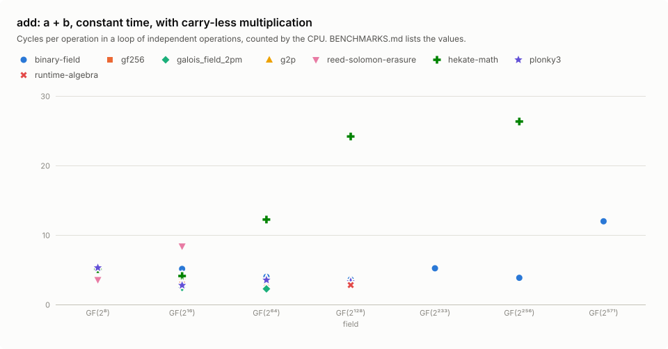

| Field | Per operation | binary-field | gf256 | galois_field_2pm | g2p | reed-solomon-erasure | hekate-math | plonky3 | runtime-algebra | compile-algebra | core-algebra | polyval | galois_field_2pm lut |
|---:|---|---:|---:|---:|---:|---:|---:|---:|---:|---:|---:|---:|---:|
| GF(2⁸) | throughput cycles | 5.1 | 5.3 | 5.1 | 5.3 | **3.6** | 5.1 | 5.3 | – | – | – | – | – |
|  | latency cycles | 3.6 | 3.3 | 3.0 | 3.1 | 5.9 | 3.3 | **3.0** | – | – | – | – | – |
|  | instructions | **8.0** | **8.0** | **8.0** | **8.0** | **8.0** | **8.0** | **8.0** | – | – | – | – | – |
| GF(2¹⁶) | throughput cycles | 5.1 | 2.9 | **2.4** | 4.1 | 8.4 | 4.1 | 2.8 | – | – | – | – | 4.2 |
|  | latency cycles | 4.1 | 4.5 | 3.6 | 3.3 | 6.1 | 6.0 | 6.5 | – | – | – | – | **3.2** |
|  | instructions | **8.0** | **8.0** | **8.0** | **8.0** | **8.0** | **8.0** | **8.0** | – | – | – | – | **8.0** |
| GF(2⁶⁴) | throughput cycles | 4.0 | 2.9 | **2.2** | – | – | 12.2 | 3.5 | – | – | – | – | – |
|  | latency cycles | 4.1 | 1.9 | **1.4** | – | – | 10.2 | 2.2 | – | – | – | – | – |
|  | instructions | **8.0** | **8.0** | **8.0** | – | – | **8.0** | **8.0** | – | – | – | – | – |
| GF(2¹²⁸) | throughput cycles | 3.6 | – | – | – | – | 24.2 | 3.3 | **2.8** | 3.9 | 3.6 | 18.6 | – |
|  | latency cycles | 4.0 | – | – | – | – | 19.6 | 2.5 | **1.5** | 2.3 | 2.3 | 18.9 | – |
|  | instructions | **8.0** | – | – | – | – | **8.0** | **8.0** | **8.0** | **8.0** | **8.0** | **8.0** | – |
| GF(2²³³) | throughput cycles | **5.2** | – | – | – | – | – | – | – | – | – | – | – |
|  | latency cycles | **2.6** | – | – | – | – | – | – | – | – | – | – | – |
|  | instructions | **11.0** | – | – | – | – | – | – | – | – | – | – | – |
| GF(2²⁵⁶) | throughput cycles | **3.8** | – | – | – | – | 26.3 | – | – | – | – | – | – |
|  | latency cycles | **2.3** | – | – | – | – | 34.2 | – | – | – | – | – | – |
|  | instructions | **11.0** | – | – | – | – | **11.0** | – | – | – | – | – | – |
| GF(2⁵⁷¹) | throughput cycles | **12.0** | – | – | – | – | – | – | – | – | – | – | – |
|  | latency cycles | **20.8** | – | – | – | – | – | – | – | – | – | – | – |
|  | instructions | **20.0** | – | – | – | – | – | – | – | – | – | – | – |

### add_vartime: a + b, variable time, with carry-less multiplication

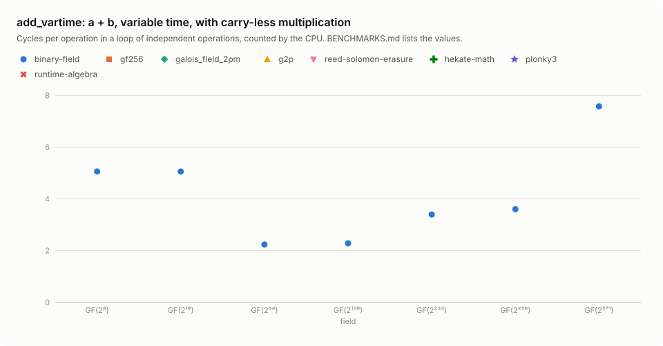

| Field | Per operation | binary-field | gf256 | galois_field_2pm | g2p | reed-solomon-erasure | hekate-math | plonky3 | runtime-algebra | compile-algebra | core-algebra | polyval | galois_field_2pm lut |
|---:|---|---:|---:|---:|---:|---:|---:|---:|---:|---:|---:|---:|---:|
| GF(2⁸) | throughput cycles | **5.1** | – | – | – | – | – | – | – | – | – | – | – |
|  | latency cycles | **3.3** | – | – | – | – | – | – | – | – | – | – | – |
|  | instructions | **8.0** | – | – | – | – | – | – | – | – | – | – | – |
| GF(2¹⁶) | throughput cycles | **5.2** | – | – | – | – | – | – | – | – | – | – | – |
|  | latency cycles | **3.4** | – | – | – | – | – | – | – | – | – | – | – |
|  | instructions | **8.0** | – | – | – | – | – | – | – | – | – | – | – |
| GF(2⁶⁴) | throughput cycles | **2.8** | – | – | – | – | – | – | – | – | – | – | – |
|  | latency cycles | **2.1** | – | – | – | – | – | – | – | – | – | – | – |
|  | instructions | **8.0** | – | – | – | – | – | – | – | – | – | – | – |
| GF(2¹²⁸) | throughput cycles | **2.3** | – | – | – | – | – | – | – | – | – | – | – |
|  | latency cycles | **2.2** | – | – | – | – | – | – | – | – | – | – | – |
|  | instructions | **8.0** | – | – | – | – | – | – | – | – | – | – | – |
| GF(2²³³) | throughput cycles | **3.5** | – | – | – | – | – | – | – | – | – | – | – |
|  | latency cycles | **2.3** | – | – | – | – | – | – | – | – | – | – | – |
|  | instructions | **11.0** | – | – | – | – | – | – | – | – | – | – | – |
| GF(2²⁵⁶) | throughput cycles | **3.5** | – | – | – | – | – | – | – | – | – | – | – |
|  | latency cycles | **2.9** | – | – | – | – | – | – | – | – | – | – | – |
|  | instructions | **11.0** | – | – | – | – | – | – | – | – | – | – | – |
| GF(2⁵⁷¹) | throughput cycles | **8.8** | – | – | – | – | – | – | – | – | – | – | – |
|  | latency cycles | **20.2** | – | – | – | – | – | – | – | – | – | – | – |
|  | instructions | **20.0** | – | – | – | – | – | – | – | – | – | – | – |

### mul: a × b, constant time, with carry-less multiplication

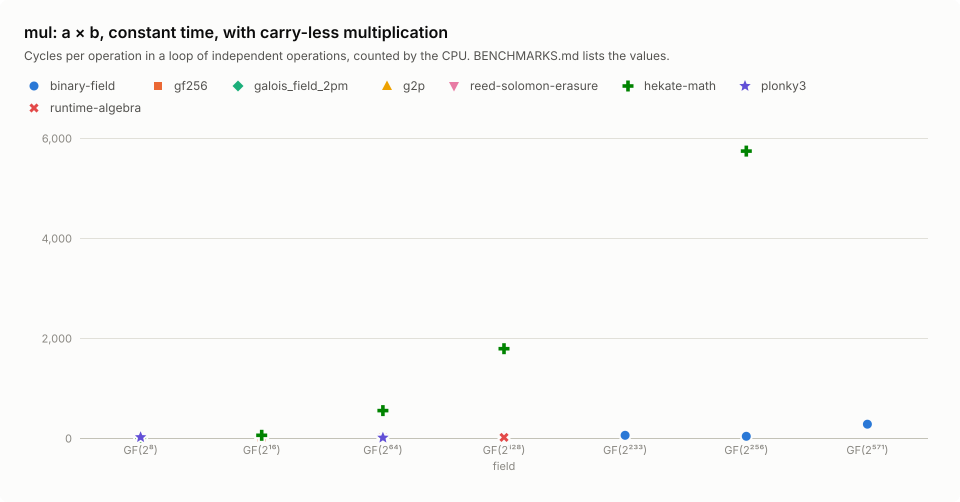

| Field | Per operation | binary-field | gf256 | galois_field_2pm | g2p | reed-solomon-erasure | hekate-math | plonky3 | runtime-algebra | compile-algebra | core-algebra | polyval | galois_field_2pm lut |
|---:|---|---:|---:|---:|---:|---:|---:|---:|---:|---:|---:|---:|---:|
| GF(2⁸) | throughput cycles | **8.1** | – | – | – | – | 14.1 | 18.0 | – | – | – | – | – |
|  | latency cycles | **21.1** | – | – | – | – | 25.9 | 33.1 | – | – | – | – | – |
|  | instructions | **31.0** | – | – | – | – | 67.0 | 59.0 | – | – | – | – | – |
| GF(2¹⁶) | throughput cycles | **8.0** | 8.1 | – | – | – | 60.1 | – | – | – | – | – | – |
|  | latency cycles | **21.1** | 29.2 | – | – | – | 54.7 | – | – | – | – | – | – |
|  | instructions | 31.0 | **18.0** | – | – | – | 236 | – | – | – | – | – | – |
| GF(2⁶⁴) | throughput cycles | 8.9 | **6.3** | – | – | – | 596 | 7.2 | – | – | – | – | – |
|  | latency cycles | **14.8** | 20.1 | – | – | – | 590 | 19.1 | – | – | – | – | – |
|  | instructions | 23.0 | **13.0** | – | – | – | 2,489 | **13.0** | – | – | – | – | – |
| GF(2¹²⁸) | throughput cycles | **11.3** | – | – | – | – | 1,876 | 12.5 | 12.7 | 30.2 | – | 119 | – |
|  | latency cycles | 17.2 | – | – | – | – | 1,835 | **16.1** | 18.7 | 30.4 | – | 145 | – |
|  | instructions | 25.0 | – | – | – | – | 7,962 | **21.0** | **21.0** | 78.0 | – | 526 | – |
| GF(2²³³) | throughput cycles | **54.2** | – | – | – | – | – | – | – | – | – | – | – |
|  | latency cycles | **55.1** | – | – | – | – | – | – | – | – | – | – | – |
|  | instructions | **136** | – | – | – | – | – | – | – | – | – | – | – |
| GF(2²⁵⁶) | throughput cycles | **34.1** | – | – | – | – | 5,759 | – | – | – | – | – | – |
|  | latency cycles | **35.7** | – | – | – | – | 5,953 | – | – | – | – | – | – |
|  | instructions | **70.0** | – | – | – | – | 25,585 | – | – | – | – | – | – |
| GF(2⁵⁷¹) | throughput cycles | **275** | – | – | – | – | – | – | – | – | – | – | – |
|  | latency cycles | **298** | – | – | – | – | – | – | – | – | – | – | – |
|  | instructions | **910** | – | – | – | – | – | – | – | – | – | – | – |

### mul_vartime: a × b, variable time, with carry-less multiplication

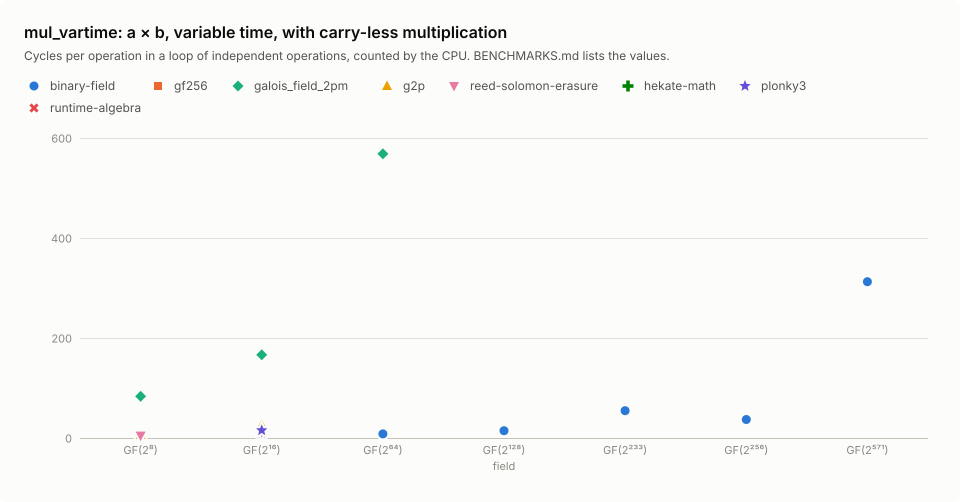

| Field | Per operation | binary-field | gf256 | galois_field_2pm | g2p | reed-solomon-erasure | hekate-math | plonky3 | runtime-algebra | compile-algebra | core-algebra | polyval | galois_field_2pm lut |
|---:|---|---:|---:|---:|---:|---:|---:|---:|---:|---:|---:|---:|---:|
| GF(2⁸) | throughput cycles | 5.2 | **4.0** | 83.4 | 6.0 | 4.7 | – | – | – | – | – | – | – |
|  | latency cycles | **12.4** | 13.5 | 89.6 | 16.0 | 14.7 | – | – | – | – | – | – | – |
|  | instructions | **11.0** | 20.0 | 323 | **11.0** | **11.0** | – | – | – | – | – | – | – |
| GF(2¹⁶) | throughput cycles | **8.0** | – | 166 | 26.0 | 11.9 | – | 15.4 | – | – | – | – | 34.1 |
|  | latency cycles | **21.4** | – | 156 | 84.3 | 27.4 | – | 31.0 | – | – | – | – | 86.2 |
|  | instructions | 31.0 | – | 627 | **22.0** | 31.0 | – | 69.0 | – | – | – | – | 31.0 |
| GF(2⁶⁴) | throughput cycles | **8.2** | – | 568 | – | – | – | – | – | – | – | – | – |
|  | latency cycles | **14.8** | – | 591 | – | – | – | – | – | – | – | – | – |
|  | instructions | **23.0** | – | 1,354 | – | – | – | – | – | – | – | – | – |
| GF(2¹²⁸) | throughput cycles | **14.7** | – | – | – | – | – | – | – | – | 686 | – | – |
|  | latency cycles | **17.3** | – | – | – | – | – | – | – | – | 653 | – | – |
|  | instructions | **25.0** | – | – | – | – | – | – | – | – | 2,064 | – | – |
| GF(2²³³) | throughput cycles | **54.7** | – | – | – | – | – | – | – | – | – | – | – |
|  | latency cycles | **56.9** | – | – | – | – | – | – | – | – | – | – | – |
|  | instructions | **136** | – | – | – | – | – | – | – | – | – | – | – |
| GF(2²⁵⁶) | throughput cycles | **36.9** | – | – | – | – | – | – | – | – | – | – | – |
|  | latency cycles | **36.4** | – | – | – | – | – | – | – | – | – | – | – |
|  | instructions | **70.0** | – | – | – | – | – | – | – | – | – | – | – |
| GF(2⁵⁷¹) | throughput cycles | **313** | – | – | – | – | – | – | – | – | – | – | – |
|  | latency cycles | **296** | – | – | – | – | – | – | – | – | – | – | – |
|  | instructions | **910** | – | – | – | – | – | – | – | – | – | – | – |

### square: a², constant time, with carry-less multiplication

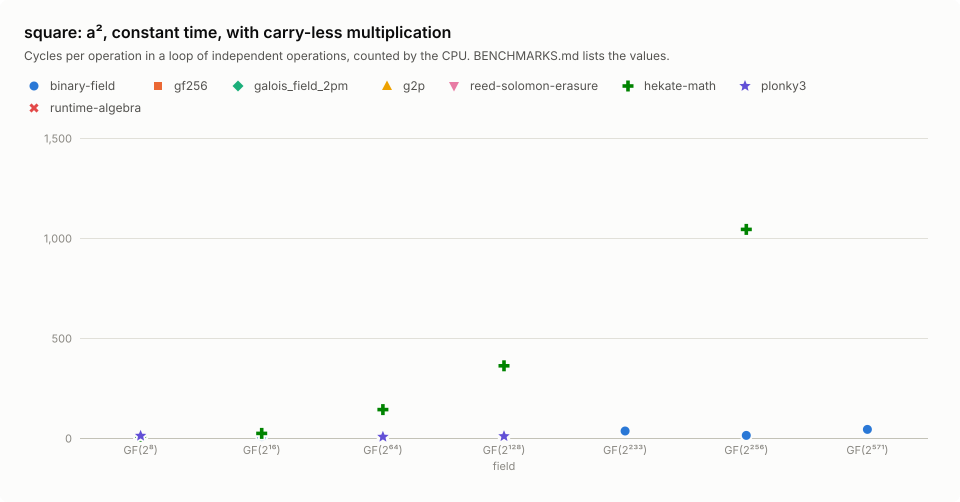

| Field | Per operation | binary-field | gf256 | galois_field_2pm | g2p | reed-solomon-erasure | hekate-math | plonky3 | runtime-algebra | compile-algebra | core-algebra | polyval | galois_field_2pm lut |
|---:|---|---:|---:|---:|---:|---:|---:|---:|---:|---:|---:|---:|---:|
| GF(2⁸) | throughput cycles | **6.5** | – | – | – | – | 9.0 | 11.1 | – | – | – | – | – |
|  | latency cycles | **17.1** | – | – | – | – | 21.1 | 25.2 | – | – | – | – | – |
|  | instructions | **21.0** | – | – | – | – | 34.0 | 34.0 | – | – | – | – | – |
| GF(2¹⁶) | throughput cycles | **7.1** | – | – | – | – | 23.1 | – | – | – | – | – | – |
|  | latency cycles | **21.0** | – | – | – | – | 35.5 | – | – | – | – | – | – |
|  | instructions | **29.0** | – | – | – | – | 90.0 | – | – | – | – | – | – |
| GF(2⁶⁴) | throughput cycles | 7.7 | – | – | – | – | 142 | **6.2** | – | – | – | – | – |
|  | latency cycles | **15.6** | – | – | – | – | 155 | 16.4 | – | – | – | – | – |
|  | instructions | 23.0 | – | – | – | – | 584 | **22.0** | – | – | – | – | – |
| GF(2¹²⁸) | throughput cycles | **7.0** | – | – | – | – | 361 | 8.8 | – | – | – | – | – |
|  | latency cycles | **14.5** | – | – | – | – | 301 | 16.6 | – | – | – | – | – |
|  | instructions | 28.0 | – | – | – | – | 1,271 | **16.0** | – | – | – | – | – |
| GF(2²³³) | throughput cycles | **34.9** | – | – | – | – | – | – | – | – | – | – | – |
|  | latency cycles | **44.5** | – | – | – | – | – | – | – | – | – | – | – |
|  | instructions | **102** | – | – | – | – | – | – | – | – | – | – | – |
| GF(2²⁵⁶) | throughput cycles | **13.2** | – | – | – | – | 1,043 | – | – | – | – | – | – |
|  | latency cycles | **19.7** | – | – | – | – | 1,149 | – | – | – | – | – | – |
|  | instructions | **37.0** | – | – | – | – | 4,090 | – | – | – | – | – | – |
| GF(2⁵⁷¹) | throughput cycles | **43.0** | – | – | – | – | – | – | – | – | – | – | – |
|  | latency cycles | **56.1** | – | – | – | – | – | – | – | – | – | – | – |
|  | instructions | **118** | – | – | – | – | – | – | – | – | – | – | – |

### square_vartime: a², variable time, with carry-less multiplication

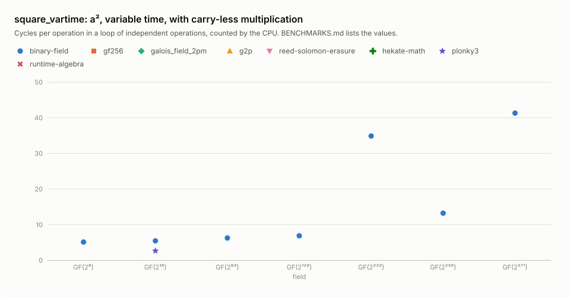

| Field | Per operation | binary-field | gf256 | galois_field_2pm | g2p | reed-solomon-erasure | hekate-math | plonky3 | runtime-algebra | compile-algebra | core-algebra | polyval | galois_field_2pm lut |
|---:|---|---:|---:|---:|---:|---:|---:|---:|---:|---:|---:|---:|---:|
| GF(2⁸) | throughput cycles | **5.2** | – | – | – | – | – | – | – | – | – | – | – |
|  | latency cycles | **7.0** | – | – | – | – | – | – | – | – | – | – | – |
|  | instructions | **8.0** | – | – | – | – | – | – | – | – | – | – | – |
| GF(2¹⁶) | throughput cycles | 6.1 | – | – | – | – | – | **3.2** | – | – | – | – | – |
|  | latency cycles | **7.2** | – | – | – | – | – | 10.1 | – | – | – | – | – |
|  | instructions | **8.0** | – | – | – | – | – | 11.0 | – | – | – | – | – |
| GF(2⁶⁴) | throughput cycles | **7.4** | – | – | – | – | – | – | – | – | – | – | – |
|  | latency cycles | **15.5** | – | – | – | – | – | – | – | – | – | – | – |
|  | instructions | **23.0** | – | – | – | – | – | – | – | – | – | – | – |
| GF(2¹²⁸) | throughput cycles | **7.1** | – | – | – | – | – | – | – | – | – | – | – |
|  | latency cycles | **14.5** | – | – | – | – | – | – | – | – | – | – | – |
|  | instructions | **28.0** | – | – | – | – | – | – | – | – | – | – | – |
| GF(2²³³) | throughput cycles | **34.8** | – | – | – | – | – | – | – | – | – | – | – |
|  | latency cycles | **44.6** | – | – | – | – | – | – | – | – | – | – | – |
|  | instructions | **102** | – | – | – | – | – | – | – | – | – | – | – |
| GF(2²⁵⁶) | throughput cycles | **13.1** | – | – | – | – | – | – | – | – | – | – | – |
|  | latency cycles | **19.7** | – | – | – | – | – | – | – | – | – | – | – |
|  | instructions | **37.0** | – | – | – | – | – | – | – | – | – | – | – |
| GF(2⁵⁷¹) | throughput cycles | **41.4** | – | – | – | – | – | – | – | – | – | – | – |
|  | latency cycles | **56.1** | – | – | – | – | – | – | – | – | – | – | – |
|  | instructions | **118** | – | – | – | – | – | – | – | – | – | – | – |

### invert: a⁻¹, constant time, with carry-less multiplication

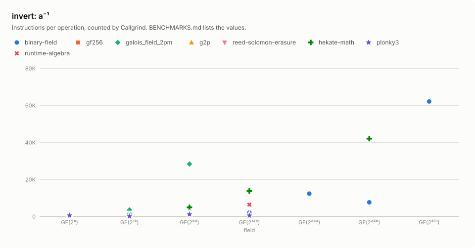

| Field | Per operation | binary-field | gf256 | galois_field_2pm | g2p | reed-solomon-erasure | hekate-math | plonky3 | runtime-algebra | compile-algebra | core-algebra | polyval | galois_field_2pm lut |
|---:|---|---:|---:|---:|---:|---:|---:|---:|---:|---:|---:|---:|---:|
| GF(2⁸) | throughput cycles | **90.8** | – | – | – | – | 268 | 322 | – | – | – | – | – |
|  | instructions | **182** | – | – | – | – | 804 | 518 | – | – | – | – | – |
| GF(2¹⁶) | throughput cycles | **209** | 424 | – | – | – | 359 | – | – | – | – | – | – |
|  | instructions | **361** | 415 | – | – | – | 1,072 | – | – | – | – | – | – |
| GF(2⁶⁴) | throughput cycles | 1,099 | 1,230 | – | – | – | 1,304 | **1,074** | – | – | – | – | – |
|  | instructions | 1,211 | **1,024** | – | – | – | 4,828 | 1,081 | – | – | – | – | – |
| GF(2¹²⁸) | throughput cycles | **2,040** | – | – | – | – | 3,650 | – | – | 5,229 | – | – | – |
|  | instructions | **3,003** | – | – | – | – | 13,595 | – | – | 13,665 | – | – | – |
| GF(2²³³) | throughput cycles | **11,062** | – | – | – | – | – | – | – | – | – | – | – |
|  | instructions | **23,596** | – | – | – | – | – | – | – | – | – | – | – |
| GF(2²⁵⁶) | throughput cycles | **5,500** | – | – | – | – | 10,226 | – | – | – | – | – | – |
|  | instructions | **8,549** | – | – | – | – | 41,587 | – | – | – | – | – | – |
| GF(2⁵⁷¹) | throughput cycles | **30,930** | – | – | – | – | – | – | – | – | – | – | – |
|  | instructions | **73,741** | – | – | – | – | – | – | – | – | – | – | – |

### invert_vartime: a⁻¹, variable time, with carry-less multiplication

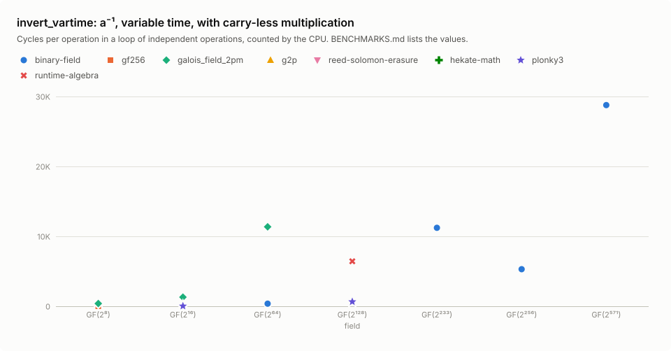

| Field | Per operation | binary-field | gf256 | galois_field_2pm | g2p | reed-solomon-erasure | hekate-math | plonky3 | runtime-algebra | compile-algebra | core-algebra | polyval | galois_field_2pm lut |
|---:|---|---:|---:|---:|---:|---:|---:|---:|---:|---:|---:|---:|---:|
| GF(2⁸) | throughput cycles | 5.2 | **4.3** | 387 | – | – | – | – | – | – | – | – | – |
|  | instructions | **13.0** | 15.0 | 1,359 | – | – | – | – | – | – | – | – | – |
| GF(2¹⁶) | throughput cycles | **5.1** | – | 1,297 | – | – | – | 28.7 | – | – | – | – | 30.8 |
|  | instructions | **12.0** | – | 3,500 | – | – | – | 95.0 | – | – | – | – | 25.0 |
| GF(2⁶⁴) | throughput cycles | **372** | – | 11,360 | – | – | – | – | – | – | – | – | – |
|  | instructions | **442** | – | 28,204 | – | – | – | – | – | – | – | – | – |
| GF(2¹²⁸) | throughput cycles | **647** | – | – | – | – | – | 653 | 6,426 | – | 162,768 | – | – |
|  | instructions | 727 | – | – | – | – | – | **493** | 6,377 | – | 533,598 | – | – |
| GF(2²³³) | throughput cycles | **11,222** | – | – | – | – | – | – | – | – | – | – | – |
|  | instructions | **23,592** | – | – | – | – | – | – | – | – | – | – | – |
| GF(2²⁵⁶) | throughput cycles | **5,299** | – | – | – | – | – | – | – | – | – | – | – |
|  | instructions | **8,550** | – | – | – | – | – | – | – | – | – | – | – |
| GF(2⁵⁷¹) | throughput cycles | **28,774** | – | – | – | – | – | – | – | – | – | – | – |
|  | instructions | **73,758** | – | – | – | – | – | – | – | – | – | – | – |

### sqrt: √a, constant time, with carry-less multiplication

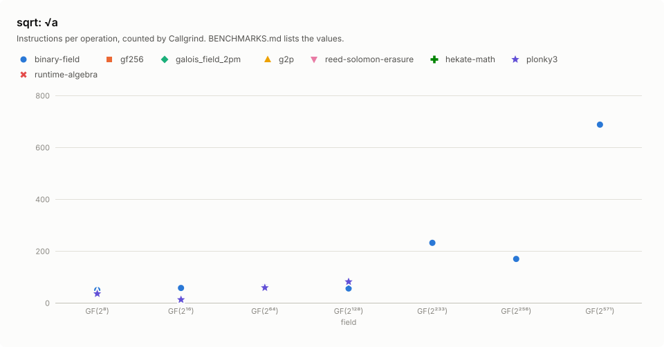

| Field | Per operation | binary-field | gf256 | galois_field_2pm | g2p | reed-solomon-erasure | hekate-math | plonky3 | runtime-algebra | compile-algebra | core-algebra | polyval | galois_field_2pm lut |
|---:|---|---:|---:|---:|---:|---:|---:|---:|---:|---:|---:|---:|---:|
| GF(2⁸) | throughput cycles | **4.8** | – | – | – | – | – | 9.7 | – | – | – | – | – |
|  | instructions | **21.0** | – | – | – | – | – | 35.0 | – | – | – | – | – |
| GF(2¹⁶) | throughput cycles | **14.9** | – | – | – | – | – | – | – | – | – | – | – |
|  | instructions | **53.0** | – | – | – | – | – | – | – | – | – | – | – |
| GF(2⁶⁴) | throughput cycles | 20.4 | – | – | – | – | – | **18.0** | – | – | – | – | – |
|  | instructions | **57.0** | – | – | – | – | – | 58.0 | – | – | – | – | – |
| GF(2¹²⁸) | throughput cycles | **18.3** | – | – | – | – | – | 20.8 | – | – | – | – | – |
|  | instructions | **44.0** | – | – | – | – | – | 81.0 | – | – | – | – | – |
| GF(2²³³) | throughput cycles | **77.5** | – | – | – | – | – | – | – | – | – | – | – |
|  | instructions | **209** | – | – | – | – | – | – | – | – | – | – | – |
| GF(2²⁵⁶) | throughput cycles | **58.8** | – | – | – | – | – | – | – | – | – | – | – |
|  | instructions | **125** | – | – | – | – | – | – | – | – | – | – | – |
| GF(2⁵⁷¹) | throughput cycles | **344** | – | – | – | – | – | – | – | – | – | – | – |
|  | instructions | **1,085** | – | – | – | – | – | – | – | – | – | – | – |

### sqrt_vartime: √a, variable time, with carry-less multiplication

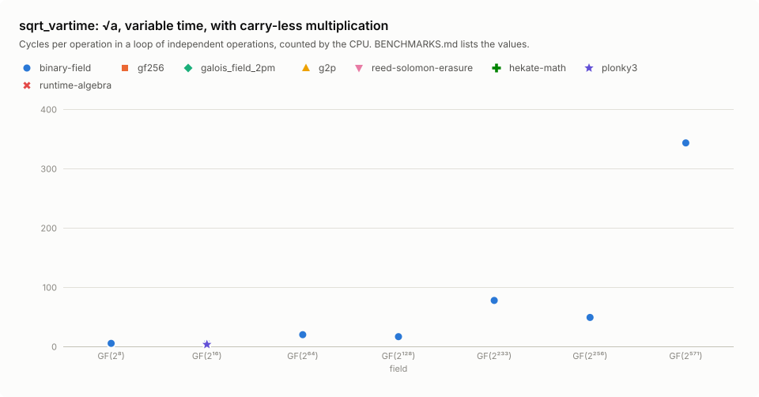

| Field | Per operation | binary-field | gf256 | galois_field_2pm | g2p | reed-solomon-erasure | hekate-math | plonky3 | runtime-algebra | compile-algebra | core-algebra | polyval | galois_field_2pm lut |
|---:|---|---:|---:|---:|---:|---:|---:|---:|---:|---:|---:|---:|---:|
| GF(2⁸) | throughput cycles | **5.4** | – | – | – | – | – | – | – | – | – | – | – |
|  | instructions | **8.0** | – | – | – | – | – | – | – | – | – | – | – |
| GF(2¹⁶) | throughput cycles | 6.6 | – | – | – | – | – | **5.4** | – | – | – | – | – |
|  | instructions | **8.0** | – | – | – | – | – | 12.0 | – | – | – | – | – |
| GF(2⁶⁴) | throughput cycles | **22.0** | – | – | – | – | – | – | – | – | – | – | – |
|  | instructions | **57.0** | – | – | – | – | – | – | – | – | – | – | – |
| GF(2¹²⁸) | throughput cycles | **18.0** | – | – | – | – | – | – | – | – | – | – | – |
|  | instructions | **44.0** | – | – | – | – | – | – | – | – | – | – | – |
| GF(2²³³) | throughput cycles | **77.5** | – | – | – | – | – | – | – | – | – | – | – |
|  | instructions | **209** | – | – | – | – | – | – | – | – | – | – | – |
| GF(2²⁵⁶) | throughput cycles | **50.3** | – | – | – | – | – | – | – | – | – | – | – |
|  | instructions | **125** | – | – | – | – | – | – | – | – | – | – | – |
| GF(2⁵⁷¹) | throughput cycles | **330** | – | – | – | – | – | – | – | – | – | – | – |
|  | instructions | **1,085** | – | – | – | – | – | – | – | – | – | – | – |

## Results without carry-less multiplication

Per operation, each row gives throughput cycles, latency cycles for the operations that have chains, and instructions. Bold marks the fewest in each row.
The charts show the first 8 crates; `compile-algebra`, `core-algebra`, `polyval` and `galois_field_2pm lut` appear in the tables only.

### add: a + b, constant time, without carry-less multiplication

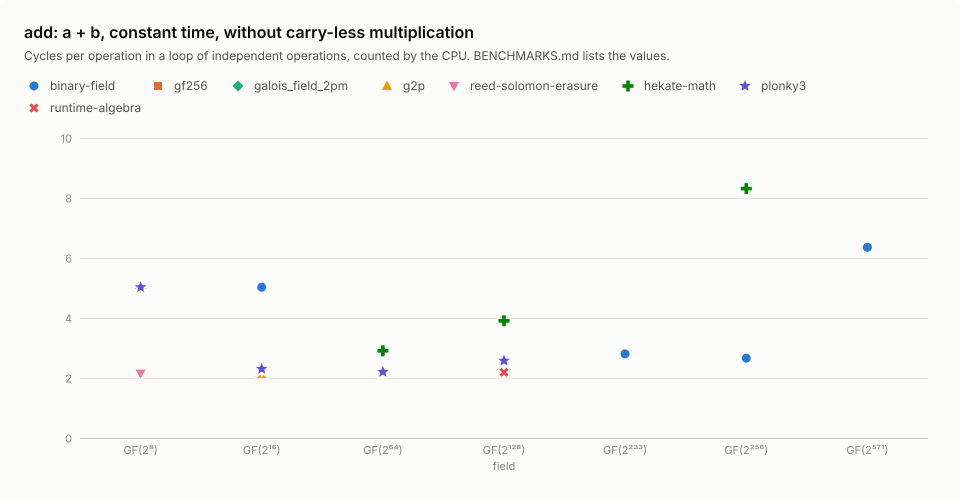

| Field | Per operation | binary-field | gf256 | galois_field_2pm | g2p | reed-solomon-erasure | hekate-math | plonky3 | runtime-algebra | compile-algebra | core-algebra | polyval | galois_field_2pm lut |
|---:|---|---:|---:|---:|---:|---:|---:|---:|---:|---:|---:|---:|---:|
| GF(2⁸) | throughput cycles | 2.5 | 2.5 | **2.2** | 3.0 | 5.1 | 2.3 | 2.6 | – | – | – | – | – |
|  | latency cycles | 3.7 | 3.1 | 3.1 | **3.1** | 4.0 | 3.4 | 3.1 | – | – | – | – | – |
|  | instructions | **8.0** | **8.0** | **8.0** | **8.0** | **8.0** | **8.0** | **8.0** | – | – | – | – | – |
| GF(2¹⁶) | throughput cycles | **2.3** | 5.1 | 5.2 | 5.2 | 5.6 | 5.4 | 5.2 | – | – | – | – | 5.3 |
|  | latency cycles | 3.1 | **3.1** | 3.2 | 3.3 | 3.4 | 3.3 | 3.6 | – | – | – | – | 3.1 |
|  | instructions | **8.0** | **8.0** | **8.0** | **8.0** | **8.0** | **8.0** | **8.0** | – | – | – | – | **8.0** |
| GF(2⁶⁴) | throughput cycles | 2.5 | **2.2** | 2.4 | – | – | 8.4 | 2.6 | – | – | – | – | – |
|  | latency cycles | **1.9** | 2.1 | 2.0 | – | – | 5.6 | 3.0 | – | – | – | – | – |
|  | instructions | **8.0** | **8.0** | **8.0** | – | – | **8.0** | **8.0** | – | – | – | – | – |
| GF(2¹²⁸) | throughput cycles | 2.6 | – | – | – | – | 14.2 | 2.9 | 2.5 | 2.6 | **2.4** | 15.3 | – |
|  | latency cycles | **1.4** | – | – | – | – | 12.4 | 4.2 | 2.1 | 2.0 | 2.1 | 15.2 | – |
|  | instructions | **8.0** | – | – | – | – | **8.0** | **8.0** | **8.0** | **8.0** | **8.0** | **8.0** | – |
| GF(2²³³) | throughput cycles | **4.7** | – | – | – | – | – | – | – | – | – | – | – |
|  | latency cycles | **2.5** | – | – | – | – | – | – | – | – | – | – | – |
|  | instructions | **8.0** | – | – | – | – | – | – | – | – | – | – | – |
| GF(2²⁵⁶) | throughput cycles | **3.8** | – | – | – | – | 25.7 | – | – | – | – | – | – |
|  | latency cycles | **3.3** | – | – | – | – | 24.3 | – | – | – | – | – | – |
|  | instructions | **8.0** | – | – | – | – | 11.0 | – | – | – | – | – | – |
| GF(2⁵⁷¹) | throughput cycles | **8.5** | – | – | – | – | – | – | – | – | – | – | – |
|  | latency cycles | **22.5** | – | – | – | – | – | – | – | – | – | – | – |
|  | instructions | **14.0** | – | – | – | – | – | – | – | – | – | – | – |

### add_vartime: a + b, variable time, without carry-less multiplication

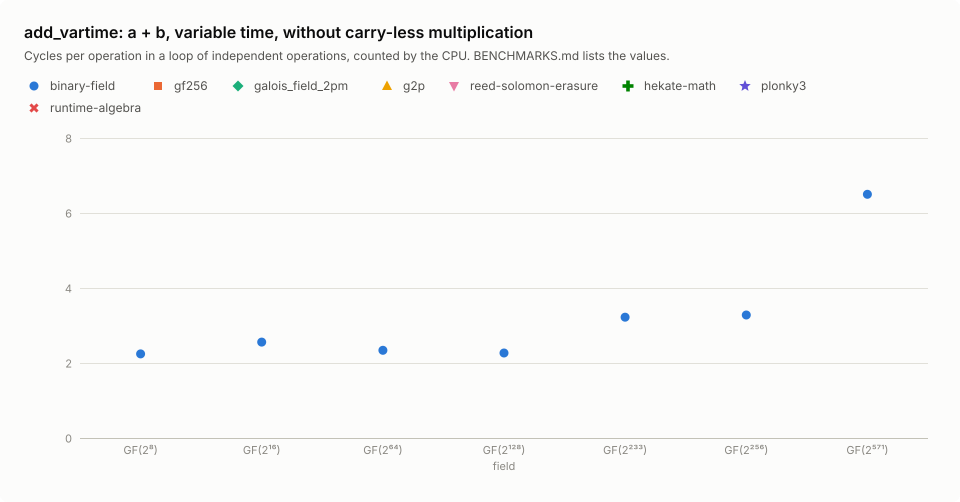

| Field | Per operation | binary-field | gf256 | galois_field_2pm | g2p | reed-solomon-erasure | hekate-math | plonky3 | runtime-algebra | compile-algebra | core-algebra | polyval | galois_field_2pm lut |
|---:|---|---:|---:|---:|---:|---:|---:|---:|---:|---:|---:|---:|---:|
| GF(2⁸) | throughput cycles | **2.2** | – | – | – | – | – | – | – | – | – | – | – |
|  | latency cycles | **3.1** | – | – | – | – | – | – | – | – | – | – | – |
|  | instructions | **8.0** | – | – | – | – | – | – | – | – | – | – | – |
| GF(2¹⁶) | throughput cycles | **2.6** | – | – | – | – | – | – | – | – | – | – | – |
|  | latency cycles | **3.1** | – | – | – | – | – | – | – | – | – | – | – |
|  | instructions | **8.0** | – | – | – | – | – | – | – | – | – | – | – |
| GF(2⁶⁴) | throughput cycles | **2.3** | – | – | – | – | – | – | – | – | – | – | – |
|  | latency cycles | **1.4** | – | – | – | – | – | – | – | – | – | – | – |
|  | instructions | **8.0** | – | – | – | – | – | – | – | – | – | – | – |
| GF(2¹²⁸) | throughput cycles | **2.3** | – | – | – | – | – | – | – | – | – | – | – |
|  | latency cycles | **1.6** | – | – | – | – | – | – | – | – | – | – | – |
|  | instructions | **8.0** | – | – | – | – | – | – | – | – | – | – | – |
| GF(2²³³) | throughput cycles | **3.2** | – | – | – | – | – | – | – | – | – | – | – |
|  | latency cycles | **2.3** | – | – | – | – | – | – | – | – | – | – | – |
|  | instructions | **8.0** | – | – | – | – | – | – | – | – | – | – | – |
| GF(2²⁵⁶) | throughput cycles | **3.3** | – | – | – | – | – | – | – | – | – | – | – |
|  | latency cycles | **2.9** | – | – | – | – | – | – | – | – | – | – | – |
|  | instructions | **8.0** | – | – | – | – | – | – | – | – | – | – | – |
| GF(2⁵⁷¹) | throughput cycles | **6.5** | – | – | – | – | – | – | – | – | – | – | – |
|  | latency cycles | **22.3** | – | – | – | – | – | – | – | – | – | – | – |
|  | instructions | **14.0** | – | – | – | – | – | – | – | – | – | – | – |

### mul: a × b, constant time, without carry-less multiplication

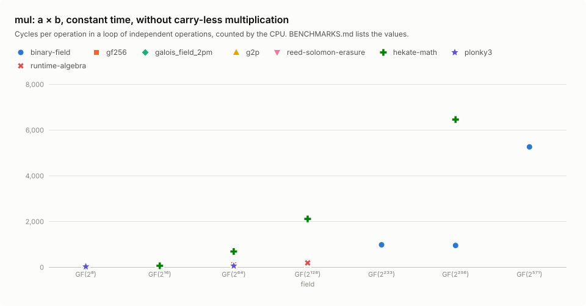

| Field | Per operation | binary-field | gf256 | galois_field_2pm | g2p | reed-solomon-erasure | hekate-math | plonky3 | runtime-algebra | compile-algebra | core-algebra | polyval | galois_field_2pm lut |
|---:|---|---:|---:|---:|---:|---:|---:|---:|---:|---:|---:|---:|---:|
| GF(2⁸) | throughput cycles | 28.5 | – | – | – | – | **14.3** | 17.1 | – | – | – | – | – |
|  | latency cycles | 39.8 | – | – | – | – | **26.1** | 32.9 | – | – | – | – | – |
|  | instructions | 109 | – | – | – | – | 67.0 | **59.0** | – | – | – | – | – |
| GF(2¹⁶) | throughput cycles | 45.1 | **30.7** | – | – | – | 54.3 | – | – | – | – | – | – |
|  | latency cycles | **52.1** | 58.3 | – | – | – | 57.9 | – | – | – | – | – | – |
|  | instructions | 138 | **133** | – | – | – | 236 | – | – | – | – | – | – |
| GF(2⁶⁴) | throughput cycles | 77.8 | 108 | – | – | – | 677 | **51.4** | – | – | – | – | – |
|  | latency cycles | **80.7** | 122 | – | – | – | 583 | 84.9 | – | – | – | – | – |
|  | instructions | 247 | 259 | – | – | – | 2,489 | **153** | – | – | – | – | – |
| GF(2¹²⁸) | throughput cycles | 258 | – | – | – | – | 2,104 | 190 | 181 | 608 | – | **148** | – |
|  | latency cycles | 243 | – | – | – | – | 1,828 | 196 | 183 | 594 | – | **138** | – |
|  | instructions | 831 | – | – | – | – | 7,962 | **499** | 542 | 2,064 | – | 526 | – |
| GF(2²³³) | throughput cycles | **971** | – | – | – | – | – | – | – | – | – | – | – |
|  | latency cycles | **1,008** | – | – | – | – | – | – | – | – | – | – | – |
|  | instructions | **2,696** | – | – | – | – | – | – | – | – | – | – | – |
| GF(2²⁵⁶) | throughput cycles | **941** | – | – | – | – | 6,450 | – | – | – | – | – | – |
|  | latency cycles | **1,097** | – | – | – | – | 6,246 | – | – | – | – | – | – |
|  | instructions | **2,990** | – | – | – | – | 25,585 | – | – | – | – | – | – |
| GF(2⁵⁷¹) | throughput cycles | **5,254** | – | – | – | – | – | – | – | – | – | – | – |
|  | latency cycles | **5,369** | – | – | – | – | – | – | – | – | – | – | – |
|  | instructions | **17,241** | – | – | – | – | – | – | – | – | – | – | – |

### mul_vartime: a × b, variable time, without carry-less multiplication

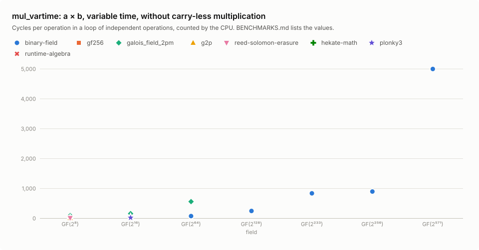

| Field | Per operation | binary-field | gf256 | galois_field_2pm | g2p | reed-solomon-erasure | hekate-math | plonky3 | runtime-algebra | compile-algebra | core-algebra | polyval | galois_field_2pm lut |
|---:|---|---:|---:|---:|---:|---:|---:|---:|---:|---:|---:|---:|---:|
| GF(2⁸) | throughput cycles | 3.6 | 3.9 | 86.0 | **3.1** | 5.7 | – | – | – | – | – | – | – |
|  | latency cycles | **12.3** | 13.5 | 90.9 | 13.0 | 13.9 | – | – | – | – | – | – | – |
|  | instructions | **11.0** | 20.0 | 323 | **11.0** | **11.0** | – | – | – | – | – | – | – |
| GF(2¹⁶) | throughput cycles | 45.3 | – | 152 | 13.5 | **10.9** | – | 14.6 | – | – | – | – | 18.5 |
|  | latency cycles | 52.2 | – | 154 | 54.5 | **26.6** | – | 30.3 | – | – | – | – | 74.1 |
|  | instructions | 138 | – | 627 | **22.0** | 31.0 | – | 69.0 | – | – | – | – | 31.0 |
| GF(2⁶⁴) | throughput cycles | **68.2** | – | 553 | – | – | – | – | – | – | – | – | – |
|  | latency cycles | **80.1** | – | 565 | – | – | – | – | – | – | – | – | – |
|  | instructions | **247** | – | 1,354 | – | – | – | – | – | – | – | – | – |
| GF(2¹²⁸) | throughput cycles | **240** | – | – | – | – | – | – | – | – | 562 | – | – |
|  | latency cycles | **233** | – | – | – | – | – | – | – | – | 553 | – | – |
|  | instructions | **831** | – | – | – | – | – | – | – | – | 2,064 | – | – |
| GF(2²³³) | throughput cycles | **830** | – | – | – | – | – | – | – | – | – | – | – |
|  | latency cycles | **861** | – | – | – | – | – | – | – | – | – | – | – |
|  | instructions | **2,696** | – | – | – | – | – | – | – | – | – | – | – |
| GF(2²⁵⁶) | throughput cycles | **890** | – | – | – | – | – | – | – | – | – | – | – |
|  | latency cycles | **984** | – | – | – | – | – | – | – | – | – | – | – |
|  | instructions | **2,990** | – | – | – | – | – | – | – | – | – | – | – |
| GF(2⁵⁷¹) | throughput cycles | **4,992** | – | – | – | – | – | – | – | – | – | – | – |
|  | latency cycles | **5,125** | – | – | – | – | – | – | – | – | – | – | – |
|  | instructions | **17,241** | – | – | – | – | – | – | – | – | – | – | – |

### square: a², constant time, without carry-less multiplication

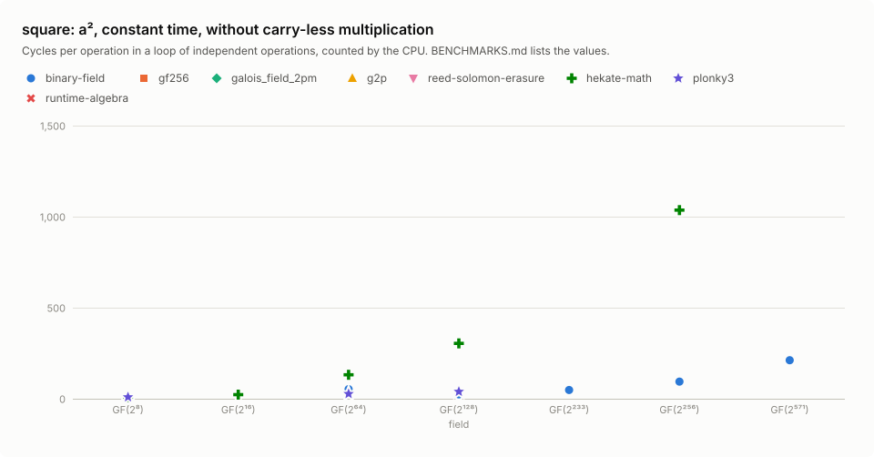

| Field | Per operation | binary-field | gf256 | galois_field_2pm | g2p | reed-solomon-erasure | hekate-math | plonky3 | runtime-algebra | compile-algebra | core-algebra | polyval | galois_field_2pm lut |
|---:|---|---:|---:|---:|---:|---:|---:|---:|---:|---:|---:|---:|---:|
| GF(2⁸) | throughput cycles | **4.7** | – | – | – | – | 8.5 | 8.8 | – | – | – | – | – |
|  | latency cycles | **17.0** | – | – | – | – | 21.3 | 25.1 | – | – | – | – | – |
|  | instructions | **21.0** | – | – | – | – | 34.0 | 34.0 | – | – | – | – | – |
| GF(2¹⁶) | throughput cycles | 26.1 | – | – | – | – | **22.4** | – | – | – | – | – | – |
|  | latency cycles | **31.1** | – | – | – | – | 35.2 | – | – | – | – | – | – |
|  | instructions | **78.0** | – | – | – | – | 90.0 | – | – | – | – | – | – |
| GF(2⁶⁴) | throughput cycles | 52.7 | – | – | – | – | 131 | **27.1** | – | – | – | – | – |
|  | latency cycles | **24.0** | – | – | – | – | 143 | 45.0 | – | – | – | – | – |
|  | instructions | 214 | – | – | – | – | 584 | **92.0** | – | – | – | – | – |
| GF(2¹²⁸) | throughput cycles | **24.1** | – | – | – | – | 304 | 39.2 | – | – | – | – | – |
|  | latency cycles | **31.0** | – | – | – | – | 301 | 44.0 | – | – | – | – | – |
|  | instructions | **113** | – | – | – | – | 1,271 | 127 | – | – | – | – | – |
| GF(2²³³) | throughput cycles | **48.0** | – | – | – | – | – | – | – | – | – | – | – |
|  | latency cycles | **56.0** | – | – | – | – | – | – | – | – | – | – | – |
|  | instructions | **184** | – | – | – | – | – | – | – | – | – | – | – |
| GF(2²⁵⁶) | throughput cycles | **93.8** | – | – | – | – | 1,036 | – | – | – | – | – | – |
|  | latency cycles | **103** | – | – | – | – | 1,105 | – | – | – | – | – | – |
|  | instructions | **327** | – | – | – | – | 4,090 | – | – | – | – | – | – |
| GF(2⁵⁷¹) | throughput cycles | **212** | – | – | – | – | – | – | – | – | – | – | – |
|  | latency cycles | **261** | – | – | – | – | – | – | – | – | – | – | – |
|  | instructions | **937** | – | – | – | – | – | – | – | – | – | – | – |

### square_vartime: a², variable time, without carry-less multiplication

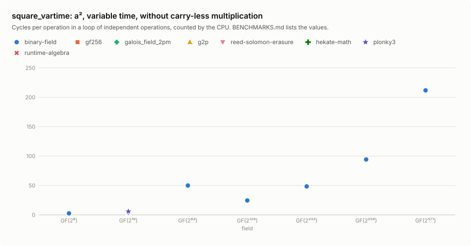

| Field | Per operation | binary-field | gf256 | galois_field_2pm | g2p | reed-solomon-erasure | hekate-math | plonky3 | runtime-algebra | compile-algebra | core-algebra | polyval | galois_field_2pm lut |
|---:|---|---:|---:|---:|---:|---:|---:|---:|---:|---:|---:|---:|---:|
| GF(2⁸) | throughput cycles | **2.1** | – | – | – | – | – | – | – | – | – | – | – |
|  | latency cycles | **7.0** | – | – | – | – | – | – | – | – | – | – | – |
|  | instructions | **8.0** | – | – | – | – | – | – | – | – | – | – | – |
| GF(2¹⁶) | throughput cycles | **3.3** | – | – | – | – | – | 5.3 | – | – | – | – | – |
|  | latency cycles | **7.2** | – | – | – | – | – | 10.1 | – | – | – | – | – |
|  | instructions | **8.0** | – | – | – | – | – | 11.0 | – | – | – | – | – |
| GF(2⁶⁴) | throughput cycles | **49.5** | – | – | – | – | – | – | – | – | – | – | – |
|  | latency cycles | **24.0** | – | – | – | – | – | – | – | – | – | – | – |
|  | instructions | **214** | – | – | – | – | – | – | – | – | – | – | – |
| GF(2¹²⁸) | throughput cycles | **24.1** | – | – | – | – | – | – | – | – | – | – | – |
|  | latency cycles | **31.1** | – | – | – | – | – | – | – | – | – | – | – |
|  | instructions | **113** | – | – | – | – | – | – | – | – | – | – | – |
| GF(2²³³) | throughput cycles | **48.0** | – | – | – | – | – | – | – | – | – | – | – |
|  | latency cycles | **56.0** | – | – | – | – | – | – | – | – | – | – | – |
|  | instructions | **184** | – | – | – | – | – | – | – | – | – | – | – |
| GF(2²⁵⁶) | throughput cycles | **93.8** | – | – | – | – | – | – | – | – | – | – | – |
|  | latency cycles | **102** | – | – | – | – | – | – | – | – | – | – | – |
|  | instructions | **327** | – | – | – | – | – | – | – | – | – | – | – |
| GF(2⁵⁷¹) | throughput cycles | **211** | – | – | – | – | – | – | – | – | – | – | – |
|  | latency cycles | **266** | – | – | – | – | – | – | – | – | – | – | – |
|  | instructions | **937** | – | – | – | – | – | – | – | – | – | – | – |

### invert: a⁻¹, constant time, without carry-less multiplication

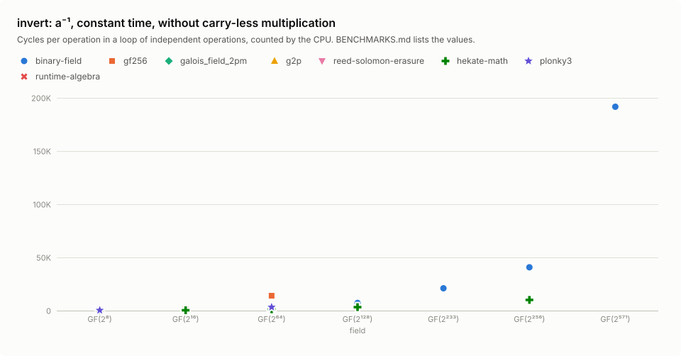

| Field | Per operation | binary-field | gf256 | galois_field_2pm | g2p | reed-solomon-erasure | hekate-math | plonky3 | runtime-algebra | compile-algebra | core-algebra | polyval | galois_field_2pm lut |
|---:|---|---:|---:|---:|---:|---:|---:|---:|---:|---:|---:|---:|---:|
| GF(2⁸) | throughput cycles | **240** | – | – | – | – | 255 | 313 | – | – | – | – | – |
|  | instructions | 604 | – | – | – | – | 804 | **518** | – | – | – | – | – |
| GF(2¹⁶) | throughput cycles | 483 | 1,151 | – | – | – | **339** | – | – | – | – | – | – |
|  | instructions | 1,294 | 3,917 | – | – | – | **1,072** | – | – | – | – | – | – |
| GF(2⁶⁴) | throughput cycles | 2,232 | 14,024 | – | – | – | **1,253** | 3,267 | – | – | – | – | – |
|  | instructions | 6,675 | 32,533 | – | – | – | **4,828** | 6,830 | – | – | – | – | – |
| GF(2¹²⁸) | throughput cycles | 7,178 | – | – | – | – | **3,296** | – | – | 145,018 | – | – | – |
|  | instructions | 21,388 | – | – | – | – | **13,595** | – | – | 525,085 | – | – | – |
| GF(2²³³) | throughput cycles | **20,983** | – | – | – | – | – | – | – | – | – | – | – |
|  | instructions | **73,276** | – | – | – | – | – | – | – | – | – | – | – |
| GF(2²⁵⁶) | throughput cycles | 40,766 | – | – | – | – | **10,071** | – | – | – | – | – | – |
|  | instructions | 123,663 | – | – | – | – | **41,587** | – | – | – | – | – | – |
| GF(2⁵⁷¹) | throughput cycles | **191,692** | – | – | – | – | – | – | – | – | – | – | – |
|  | instructions | **765,628** | – | – | – | – | – | – | – | – | – | – | – |

### invert_vartime: a⁻¹, variable time, without carry-less multiplication

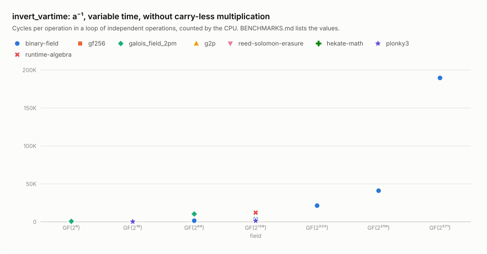

| Field | Per operation | binary-field | gf256 | galois_field_2pm | g2p | reed-solomon-erasure | hekate-math | plonky3 | runtime-algebra | compile-algebra | core-algebra | polyval | galois_field_2pm lut |
|---:|---|---:|---:|---:|---:|---:|---:|---:|---:|---:|---:|---:|---:|
| GF(2⁸) | throughput cycles | **3.7** | 5.7 | 395 | – | – | – | – | – | – | – | – | – |
|  | instructions | **13.0** | 15.0 | 1,357 | – | – | – | – | – | – | – | – | – |
| GF(2¹⁶) | throughput cycles | **3.5** | – | 1,245 | – | – | – | 22.0 | – | – | – | – | 14.8 |
|  | instructions | **12.0** | – | 3,485 | – | – | – | 95.0 | – | – | – | – | 25.0 |
| GF(2⁶⁴) | throughput cycles | **1,226** | – | 10,067 | – | – | – | – | – | – | – | – | – |
|  | instructions | **3,571** | – | 28,262 | – | – | – | – | – | – | – | – | – |
| GF(2¹²⁸) | throughput cycles | 3,541 | – | – | – | – | – | **1,134** | 11,797 | – | 154,749 | – | – |
|  | instructions | 11,081 | – | – | – | – | – | **3,897** | 31,444 | – | 533,598 | – | – |
| GF(2²³³) | throughput cycles | **21,038** | – | – | – | – | – | – | – | – | – | – | – |
|  | instructions | **73,264** | – | – | – | – | – | – | – | – | – | – | – |
| GF(2²⁵⁶) | throughput cycles | **40,757** | – | – | – | – | – | – | – | – | – | – | – |
|  | instructions | **123,661** | – | – | – | – | – | – | – | – | – | – | – |
| GF(2⁵⁷¹) | throughput cycles | **189,358** | – | – | – | – | – | – | – | – | – | – | – |
|  | instructions | **765,630** | – | – | – | – | – | – | – | – | – | – | – |

### sqrt: √a, constant time, without carry-less multiplication

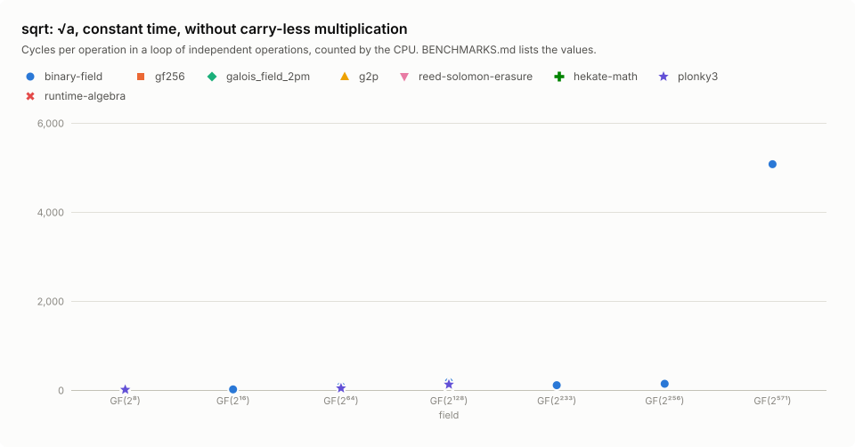

| Field | Per operation | binary-field | gf256 | galois_field_2pm | g2p | reed-solomon-erasure | hekate-math | plonky3 | runtime-algebra | compile-algebra | core-algebra | polyval | galois_field_2pm lut |
|---:|---|---:|---:|---:|---:|---:|---:|---:|---:|---:|---:|---:|---:|
| GF(2⁸) | throughput cycles | **4.9** | – | – | – | – | – | 9.9 | – | – | – | – | – |
|  | instructions | **21.0** | – | – | – | – | – | 35.0 | – | – | – | – | – |
| GF(2¹⁶) | throughput cycles | **13.7** | – | – | – | – | – | – | – | – | – | – | – |
|  | instructions | **53.0** | – | – | – | – | – | – | – | – | – | – | – |
| GF(2⁶⁴) | throughput cycles | 88.5 | – | – | – | – | – | **40.6** | – | – | – | – | – |
|  | instructions | 250 | – | – | – | – | – | **161** | – | – | – | – | – |
| GF(2¹²⁸) | throughput cycles | 203 | – | – | – | – | – | **126** | – | – | – | – | – |
|  | instructions | 603 | – | – | – | – | – | **444** | – | – | – | – | – |
| GF(2²³³) | throughput cycles | **117** | – | – | – | – | – | – | – | – | – | – | – |
|  | instructions | **523** | – | – | – | – | – | – | – | – | – | – | – |
| GF(2²⁵⁶) | throughput cycles | **143** | – | – | – | – | – | – | – | – | – | – | – |
|  | instructions | **663** | – | – | – | – | – | – | – | – | – | – | – |
| GF(2⁵⁷¹) | throughput cycles | **5,218** | – | – | – | – | – | – | – | – | – | – | – |
|  | instructions | **17,072** | – | – | – | – | – | – | – | – | – | – | – |

### sqrt_vartime: √a, variable time, without carry-less multiplication

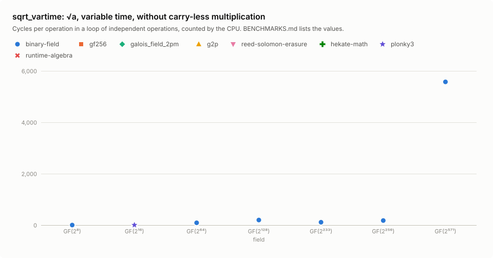

| Field | Per operation | binary-field | gf256 | galois_field_2pm | g2p | reed-solomon-erasure | hekate-math | plonky3 | runtime-algebra | compile-algebra | core-algebra | polyval | galois_field_2pm lut |
|---:|---|---:|---:|---:|---:|---:|---:|---:|---:|---:|---:|---:|---:|
| GF(2⁸) | throughput cycles | **2.3** | – | – | – | – | – | – | – | – | – | – | – |
|  | instructions | **8.0** | – | – | – | – | – | – | – | – | – | – | – |
| GF(2¹⁶) | throughput cycles | 3.8 | – | – | – | – | – | **3.3** | – | – | – | – | – |
|  | instructions | **8.0** | – | – | – | – | – | 12.0 | – | – | – | – | – |
| GF(2⁶⁴) | throughput cycles | **89.4** | – | – | – | – | – | – | – | – | – | – | – |
|  | instructions | **250** | – | – | – | – | – | – | – | – | – | – | – |
| GF(2¹²⁸) | throughput cycles | **197** | – | – | – | – | – | – | – | – | – | – | – |
|  | instructions | **603** | – | – | – | – | – | – | – | – | – | – | – |
| GF(2²³³) | throughput cycles | **111** | – | – | – | – | – | – | – | – | – | – | – |
|  | instructions | **523** | – | – | – | – | – | – | – | – | – | – | – |
| GF(2²⁵⁶) | throughput cycles | **178** | – | – | – | – | – | – | – | – | – | – | – |
|  | instructions | **663** | – | – | – | – | – | – | – | – | – | – | – |
| GF(2⁵⁷¹) | throughput cycles | **5,575** | – | – | – | – | – | – | – | – | – | – | – |
|  | instructions | **17,072** | – | – | – | – | – | – | – | – | – | – | – |

## Reproduce

```sh
cargo run -p binary-field-bench-report -- bench    # the CPU's counts of the native build
cargo run -p binary-field-bench-report -- report   # this file and benchmarks/*.svg
```
