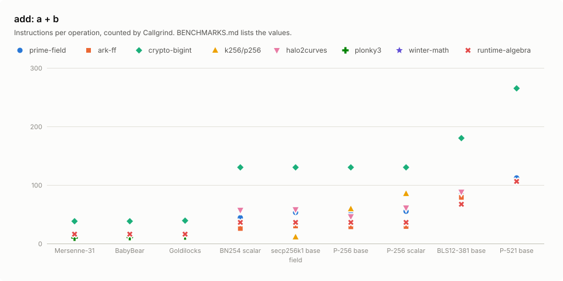
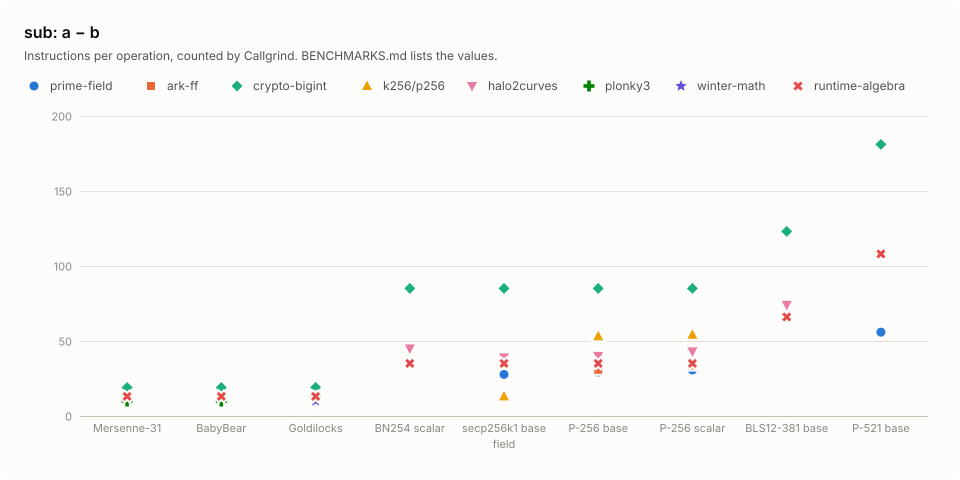
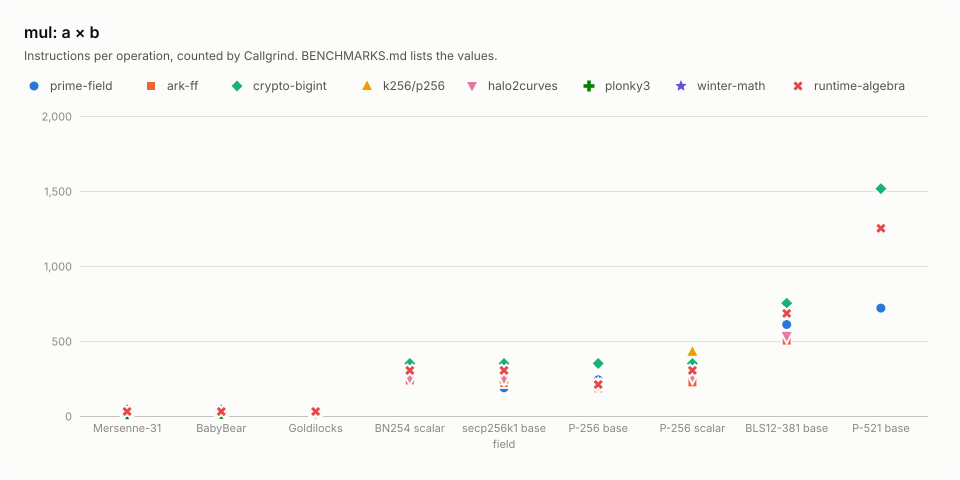
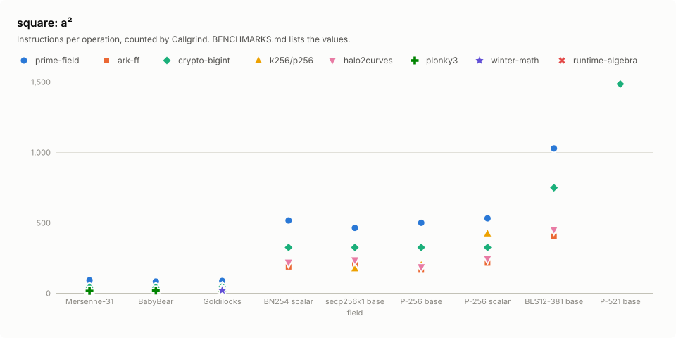
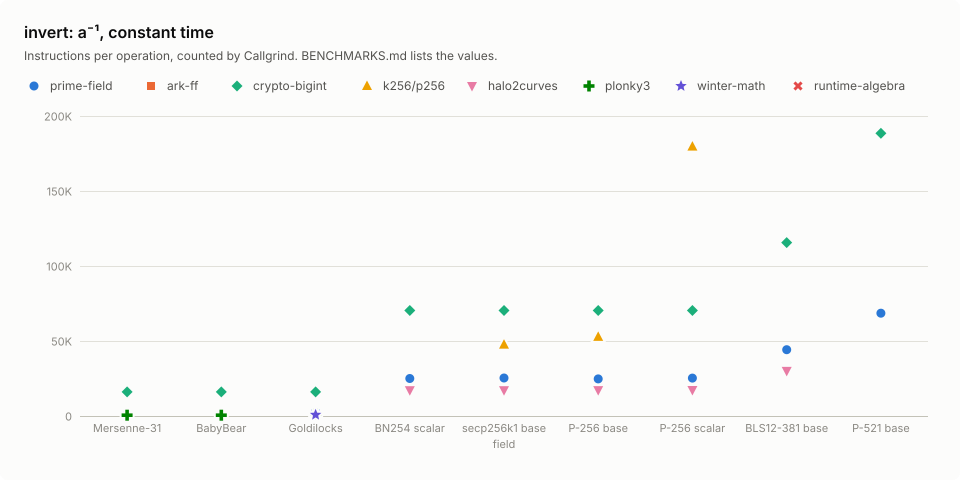
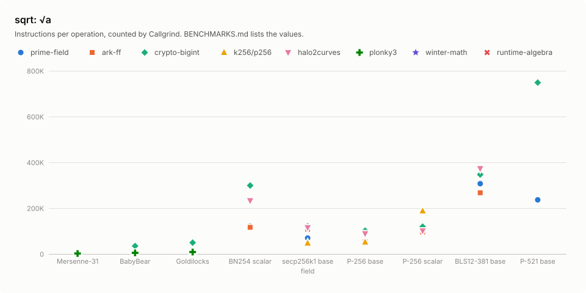

# Benchmarks

`prime-field` at commit `66763e0` against `ark-ff`, `crypto-bigint`, `k256/p256`, `halo2curves`, `plonky3`, `winter-math`, `runtime-algebra` and `compile-algebra`: add, sub, mul, square, invert, invert_vartime and sqrt over Mersenne-31, BabyBear, Goldilocks, BN254 scalar, secp256k1 base, P-256 base, P-256 scalar, BLS12-381 base and P-521 base, in instructions per operation, counted on 2026-11-02.

## Setup

|  |  |
|---|---|
| CPU | AMD Ryzen 9 5950X 16-Core Processor (`znver3`) |
| Compiler | rustc 1.99.1 (58cf8f9c3 2026-10-13), LLVM 23.1.1, `bench` profile, `-C target-cpu=native -C target-feature=-sse4a,-vpclmulqdq -C codegen-units=1` |
| Counter | Valgrind 3.22.0, Callgrind |
| Crates | ark-ff 0.6.0, crypto-bigint 0.7.10, k256 0.13.4, p256 0.13.2, halo2curves 0.10.0, p3-field 0.9.0-rc.2, winter-math 0.13.1, runtime-algebra 0.1.0, compile-algebra 0.1.0 |

## Method

Each case runs one crate's function over 256 operand sets, the same canonical residues for every crate in a row, with operands and results behind `core::hint::black_box`. Callgrind counts the instructions of the loop over the batch, including the functions it calls, such as the allocator of `compile-algebra`; each count is that total divided by 256. The loop's own loads and stores are part of every count. Every instruction counts as one, whatever its latency. The counts are exact at any machine load. Before a case is counted, every result is checked against `num-bigint`: the exact residue, `a^(p - 2)` for the inverses, and either root for `sqrt`. Elements enter and leave each crate in its own representation; the conversions lie outside the count.

| Operation | Operands |
|---|---|
| add, sub, mul | `a` and `b` uniform below `p` |
| square, invert, invert_vartime | `a` uniform in `[1, p)` |
| sqrt | `a = r²` for `r` uniform in `[1, p)`, so that a root exists |

## Functions

Each cell counts the crate's own function:

| Operation | prime-field | ark-ff | crypto-bigint | k256/p256 | halo2curves | plonky3 | winter-math | runtime-algebra | compile-algebra |
|---|---|---|---|---|---|---|---|---|---|
| add | `+` | `+` over BN254 scalar, secp256k1 base, P-256 base, P-256 scalar and BLS12-381 base | `+` | `+` over secp256k1 base, P-256 base and P-256 scalar | `+` over BN254 scalar, secp256k1 base, P-256 base, P-256 scalar and BLS12-381 base | `+` over Mersenne-31, BabyBear and Goldilocks | `+` over Goldilocks | `addf` | `addf` over P-256 base and P-256 scalar |
| sub | `-` | `-` over BN254 scalar, secp256k1 base, P-256 base, P-256 scalar and BLS12-381 base | `-` | `-` over secp256k1 base, P-256 base and P-256 scalar | `-` over BN254 scalar, secp256k1 base, P-256 base, P-256 scalar and BLS12-381 base | `-` over Mersenne-31, BabyBear and Goldilocks | `-` over Goldilocks | `subf` | `subf` over P-256 base and P-256 scalar |
| mul | `*` | `*` over BN254 scalar, secp256k1 base, P-256 base, P-256 scalar and BLS12-381 base | `*` | `*` over secp256k1 base, P-256 base and P-256 scalar | `*` over BN254 scalar, secp256k1 base, P-256 base, P-256 scalar and BLS12-381 base | `*` over Mersenne-31, BabyBear and Goldilocks | `*` over Goldilocks | `mulf` | `mulf` over P-256 base and P-256 scalar |
| square | `square` | `square` over BN254 scalar, secp256k1 base, P-256 base, P-256 scalar and BLS12-381 base | `square` | `square` over secp256k1 base, P-256 base and P-256 scalar | `square` over BN254 scalar, secp256k1 base, P-256 base, P-256 scalar and BLS12-381 base | `square` over Mersenne-31, BabyBear and Goldilocks | `square` over Goldilocks | – | – |
| invert | `invert` | – | `invert` | `invert` over secp256k1 base, P-256 base and P-256 scalar | – | `try_inverse` over Mersenne-31, BabyBear and Goldilocks | `inv` over Goldilocks | – | – |
| invert_vartime | `invert_vartime` | `inverse` over BN254 scalar, secp256k1 base, P-256 base, P-256 scalar and BLS12-381 base | `invert_vartime` | – | `invert` over BN254 scalar, secp256k1 base, P-256 base, P-256 scalar and BLS12-381 base | – | – | `invert` | `invert` over P-256 base and P-256 scalar |
| sqrt | `sqrt` | `sqrt` over BN254 scalar, secp256k1 base, P-256 base, P-256 scalar and BLS12-381 base | `sqrt` | `sqrt` over secp256k1 base, P-256 base and P-256 scalar | `sqrt` over BN254 scalar, secp256k1 base, P-256 base, P-256 scalar and BLS12-381 base | `tonelli_shanks` over Mersenne-31, BabyBear and Goldilocks | – | – | – |

- `prime-field`, `ark-ff`, `crypto-bigint`, `halo2curves` and `runtime-algebra` are generic over the modulus; `k256`, `p256`, `p3-*` and `winter-math` are written for their field.
- `crypto-bigint` is `ConstMontyForm` with a `const_monty_params!` modulus.
- `ark-ff` is `Fp` with `MontBackend` from the arkworks curve crates; its `inverse` and `sqrt` run in variable time.
- `plonky3` is `p3-mersenne-31`, `p3-baby-bear` and `p3-goldilocks` on their field; its inverse is a Fermat exponentiation by an addition chain.
- `runtime-algebra` and `compile-algebra` are longfellow-zk's prover-side and compile-side fields: `FpGenericField` is their generic Montgomery field with the modulus held at run time; `P256Field` adds a hand-written P-256 strategy; `compile-algebra`'s `FpField` computes on `num-bigint`.
- No arkworks crate declares the field: `ark-ff` over Mersenne-31, BabyBear, Goldilocks and P-521 base.
- The inverse runs in variable time: `ark-ff` invert over BN254 scalar, secp256k1 base, P-256 base, P-256 scalar and BLS12-381 base, `halo2curves` invert over BN254 scalar, secp256k1 base, P-256 base, P-256 scalar and BLS12-381 base and `runtime-algebra` invert.
- No RustCrypto crate declares the field: `k256/p256` over Mersenne-31, BabyBear, Goldilocks, BN254 scalar and BLS12-381 base.
- P521 keeps its field element private: `k256/p256` over P-521 base.
- No variable-time inverse: `k256/p256` invert_vartime over secp256k1 base, P-256 base and P-256 scalar, `plonky3` invert_vartime over Mersenne-31, BabyBear and Goldilocks and `winter-math` invert_vartime over Goldilocks.
- Halo2curves declares no such field: `halo2curves` over Mersenne-31, BabyBear, Goldilocks and P-521 base.
- Plonky3 declares no such field: `plonky3` over BN254 scalar, secp256k1 base, P-256 base, P-256 scalar, BLS12-381 base and P-521 base.
- Winter-math declares no such field: `winter-math` over Mersenne-31, BabyBear, BN254 scalar, secp256k1 base, P-256 base, P-256 scalar, BLS12-381 base and P-521 base.
- No square root: `winter-math` sqrt over Goldilocks, `runtime-algebra` sqrt and `compile-algebra` sqrt over P-256 base and P-256 scalar.
- No squaring function: `runtime-algebra` square and `compile-algebra` square over P-256 base and P-256 scalar.
- Compile-algebra declares P-256 base and scalar only: `compile-algebra` over Mersenne-31, BabyBear, Goldilocks, BN254 scalar, secp256k1 base, BLS12-381 base and P-521 base.
- The inverse is a variable-time `modpow`: `compile-algebra` invert over P-256 base and P-256 scalar.

## Results

Each cell: instructions per operation. Bold marks the fewest in each row.
The charts show the first 8 crates; `compile-algebra` appears in the tables only.

### add: a + b



| Field | prime-field | ark-ff | crypto-bigint | k256/p256 | halo2curves | plonky3 | winter-math | runtime-algebra | compile-algebra |
|---:|---:|---:|---:|---:|---:|---:|---:|---:|---:|
| Mersenne-31 | 14.0 | – | 38.1 | – | – | **10.0** | – | 16.0 | – |
| BabyBear | 14.0 | – | 38.1 | – | – | **11.0** | – | 16.0 | – |
| Goldilocks | 21.0 | – | 39.1 | – | – | **12.0** | 16.0 | 16.0 | – |
| BN254 scalar | 66.1 | **25.7** | 144 | – | 57.1 | – | – | 36.1 | – |
| secp256k1 base | 55.1 | 30.0 | 144 | **11.0** | 58.1 | – | – | 36.1 | – |
| P-256 base | 58.1 | **28.6** | 144 | 59.1 | 46.1 | – | – | 36.1 | 1,404 |
| P-256 scalar | 67.1 | **29.1** | 144 | 85.1 | 61.1 | – | – | 36.1 | 1,383 |
| BLS12-381 base | 91.1 | **35.5** | 176 | – | 88.1 | – | – | 67.1 | – |
| P-521 base | **104** | – | 261 | – | – | – | – | 106 | – |

### sub: a − b



| Field | prime-field | ark-ff | crypto-bigint | k256/p256 | halo2curves | plonky3 | winter-math | runtime-algebra | compile-algebra |
|---:|---:|---:|---:|---:|---:|---:|---:|---:|---:|
| Mersenne-31 | 13.0 | – | 19.0 | – | – | **10.0** | – | 13.0 | – |
| BabyBear | 13.0 | – | 19.0 | – | – | **10.0** | – | 13.0 | – |
| Goldilocks | 13.0 | – | 19.0 | – | – | 12.0 | **10.0** | 13.0 | – |
| BN254 scalar | 40.1 | 35.3 | 91.1 | – | 45.1 | – | – | **35.1** | – |
| secp256k1 base | 35.1 | 35.0 | 91.1 | **13.0** | 39.1 | – | – | 35.1 | – |
| P-256 base | 35.1 | **30.8** | 91.1 | 53.1 | 40.1 | – | – | 35.1 | 602 |
| P-256 scalar | 38.1 | **33.6** | 91.1 | 54.1 | 43.1 | – | – | 35.1 | 596 |
| BLS12-381 base | 61.1 | **53.2** | 119 | – | 74.1 | – | – | 66.1 | – |
| P-521 base | **56.1** | – | 187 | – | – | – | – | 108 | – |

### mul: a × b



| Field | prime-field | ark-ff | crypto-bigint | k256/p256 | halo2curves | plonky3 | winter-math | runtime-algebra | compile-algebra |
|---:|---:|---:|---:|---:|---:|---:|---:|---:|---:|
| Mersenne-31 | 21.0 | – | 40.1 | – | – | **15.0** | – | 30.1 | – |
| BabyBear | 19.1 | – | 40.1 | – | – | **17.0** | – | 30.1 | – |
| Goldilocks | 26.0 | – | 44.1 | – | – | **18.0** | 18.0 | 30.1 | – |
| BN254 scalar | 269 | **238** | 350 | – | 254 | – | – | 304 | – |
| secp256k1 base | **188** | 220 | 350 | 244 | 251 | – | – | 304 | – |
| P-256 base | 241 | **185** | 350 | 204 | 204 | – | – | 210 | 2,376 |
| P-256 scalar | 289 | **224** | 350 | 428 | 263 | – | – | 304 | 2,383 |
| BLS12-381 base | 610 | **502** | 752 | – | 534 | – | – | 684 | – |
| P-521 base | **719** | – | 1,515 | – | – | – | – | 1,251 | – |

### square: a²



| Field | prime-field | ark-ff | crypto-bigint | k256/p256 | halo2curves | plonky3 | winter-math | runtime-algebra | compile-algebra |
|---:|---:|---:|---:|---:|---:|---:|---:|---:|---:|
| Mersenne-31 | 21.0 | – | 40.1 | – | – | **14.0** | – | – | – |
| BabyBear | 19.1 | – | 40.1 | – | – | **16.0** | – | – | – |
| Goldilocks | 26.0 | – | 44.1 | – | – | **18.0** | 18.0 | – | – |
| BN254 scalar | 217 | **192** | 311 | – | 217 | – | – | – | – |
| secp256k1 base | **152** | 211 | 311 | 172 | 233 | – | – | – | – |
| P-256 base | 184 | **176** | 311 | 198 | 180 | – | – | – | – |
| P-256 scalar | 234 | **217** | 311 | 421 | 243 | – | – | – | – |
| BLS12-381 base | 476 | **403** | 756 | – | 448 | – | – | – | – |
| P-521 base | **524** | – | 1,514 | – | – | – | – | – | – |

### invert: a⁻¹, constant time



| Field | prime-field | ark-ff | crypto-bigint | k256/p256 | halo2curves | plonky3 | winter-math | runtime-algebra | compile-algebra |
|---:|---:|---:|---:|---:|---:|---:|---:|---:|---:|
| Mersenne-31 | 761 | – | 15,956 | – | – | **556** | – | – | – |
| BabyBear | 693 | – | 15,956 | – | – | **554** | – | – | – |
| Goldilocks | 1,759 | – | 15,958 | – | – | 1,201 | **825** | – | – |
| BN254 scalar | **27,264** | – | 70,409 | – | – | – | – | – | – |
| secp256k1 base | **27,179** | – | 70,409 | 47,554 | – | – | – | – | – |
| P-256 base | **26,632** | – | 70,408 | 52,756 | – | – | – | – | – |
| P-256 scalar | **27,481** | – | 70,409 | 179,732 | – | – | – | – | – |
| BLS12-381 base | **43,454** | – | 115,416 | – | – | – | – | – | – |
| P-521 base | **68,844** | – | 190,053 | – | – | – | – | – | – |

### invert_vartime: a⁻¹, variable time


| Field | prime-field | ark-ff | crypto-bigint | k256/p256 | halo2curves | plonky3 | winter-math | runtime-algebra | compile-algebra |
|---:|---:|---:|---:|---:|---:|---:|---:|---:|---:|
| Mersenne-31 | **748** | – | 2,438 | – | – | – | – | 988 | – |
| BabyBear | **688** | – | 2,404 | – | – | – | – | 990 | – |
| Goldilocks | **1,753** | – | 4,508 | – | – | – | – | 1,983 | – |
| BN254 scalar | **15,420** | 25,889 | 24,833 | – | 16,788 | – | – | 29,625 | – |
| secp256k1 base | **13,442** | 27,203 | 24,840 | – | 16,891 | – | – | 29,965 | – |
| P-256 base | **15,001** | 24,515 | 24,838 | – | 16,892 | – | – | 29,769 | 357,438 |
| P-256 scalar | **13,707** | 24,088 | 24,850 | – | 16,875 | – | – | 29,909 | 357,923 |
| BLS12-381 base | **27,515** | 59,272 | 44,557 | – | 29,167 | – | – | 75,552 | – |
| P-521 base | **43,990** | – | 73,800 | – | – | – | – | 177,489 | – |

### sqrt: √a



| Field | prime-field | ark-ff | crypto-bigint | k256/p256 | halo2curves | plonky3 | winter-math | runtime-algebra | compile-algebra |
|---:|---:|---:|---:|---:|---:|---:|---:|---:|---:|
| Mersenne-31 | **493** | – | 1,973 | – | – | 1,867 | – | – | – |
| BabyBear | **4,106** | – | 33,620 | – | – | 4,689 | – | – | – |
| Goldilocks | 8,523 | – | 47,926 | – | – | **8,475** | – | – | – |
| BN254 scalar | **104,452** | 114,876 | 289,275 | – | 226,432 | – | – | – | – |
| secp256k1 base | **32,751** | 107,600 | 123,520 | 46,981 | 116,563 | – | – | – | – |
| P-256 base | **41,268** | 52,501 | 104,904 | 51,576 | 90,135 | – | – | – | – |
| P-256 scalar | **68,128** | 94,023 | 121,877 | 188,048 | 100,476 | – | – | – | – |
| BLS12-381 base | **243,174** | 265,844 | 341,921 | – | 398,845 | – | – | – | – |
| P-521 base | **224,749** | – | 767,489 | – | – | – | – | – | – |

## Reproduce

```sh
cargo run -p prime-field-bench-report -- bench    # Callgrind counts of the native build
cargo run -p prime-field-bench-report -- report   # this file and benchmarks/*.svg
```
