# Benchmarks

`prime-field` at commit `3264a60` against `ark-ff`, `crypto-bigint`, `k256/p256`, `halo2curves`, `plonky3`, `winter-math`, `runtime-algebra` and `compile-algebra`: add_vartime, add_ct, sub_vartime, sub_ct, mul_vartime, mul_ct, square_vartime, square_ct, invert_vartime, invert_ct, sqrt_vartime and sqrt_ct over Mersenne-31, BabyBear, Goldilocks, BN254 scalar, secp256k1 base, P-256 base, P-256 scalar, BLS12-381 base and P-521 base, in instructions per operation, counted on 2026-11-02.

## Setup

|  |  |
|---|---|
| CPU | AMD Ryzen 9 5950X 16-Core Processor (`znver3`) |
| Compiler | rustc 1.99.1 (58cf8f9c3 2026-10-13), LLVM 23.1.1, `bench` profile, `-C target-cpu=native -C target-feature=-sse4a,-vpclmulqdq -C codegen-units=1` |
| Counter | Valgrind 3.22.0, Callgrind |
| Crates | ark-ff 0.6.0, crypto-bigint 0.7.10, k256 0.13.4, p256 0.13.2, halo2curves 0.10.0, p3-field 0.9.0-rc.2, winter-math 0.13.1, runtime-algebra 0.1.0, compile-algebra 0.1.0 |

## Method

Each case runs one crate's function over 256 operand sets, the same canonical residues for every crate in both rows of an operation, with operands and results behind `core::hint::black_box`. Callgrind counts the instructions of the loop over the batch, including the functions it calls, such as the allocator of `compile-algebra`; each count is that total divided by 256. The loop's own loads and stores are part of every count. Every instruction counts as one, whatever its latency. The counts are exact at any machine load. Before a case is counted, every result is checked against `num-bigint`: the exact residue, `a^(p - 2)` for the inverses, and either root for `sqrt`. Elements enter and leave each crate in its own representation; the conversions lie outside the count.

| Operation | Operands |
|---|---|
| add, sub, mul | `a` and `b` uniform below `p` |
| square, invert | `a` uniform in `[1, p)` |
| sqrt | `a = r²` for `r` uniform in `[1, p)`, so that a root exists |

## Functions

Each cell counts the crate's own function:

| Operation | prime-field | ark-ff | crypto-bigint | k256/p256 | halo2curves | plonky3 | winter-math | runtime-algebra | compile-algebra |
|---|---|---|---|---|---|---|---|---|---|
| add_vartime | `+` | `+` over BN254 scalar, secp256k1 base, P-256 base, P-256 scalar and BLS12-381 base | – | – | – | `+` over Mersenne-31, BabyBear and Goldilocks | – | – | `addf` over P-256 base and P-256 scalar |
| add_ct | `Secret +` | – | `+` | `+` over secp256k1 base, P-256 base and P-256 scalar | `+` over BN254 scalar, secp256k1 base, P-256 base, P-256 scalar and BLS12-381 base | – | `+` over Goldilocks | `addf` | – |
| sub_vartime | `-` | `-` over BN254 scalar, secp256k1 base, P-256 base, P-256 scalar and BLS12-381 base | – | – | – | `-` over BabyBear and Goldilocks | – | – | `subf` over P-256 base and P-256 scalar |
| sub_ct | `Secret -` | – | `-` | `-` over secp256k1 base, P-256 base and P-256 scalar | `-` over BN254 scalar, secp256k1 base, P-256 base, P-256 scalar and BLS12-381 base | `-` over Mersenne-31 | `-` over Goldilocks | `subf` | – |
| mul_vartime | `*` | `*` over BN254 scalar, secp256k1 base, P-256 base, P-256 scalar and BLS12-381 base | – | – | – | `*` over Mersenne-31, BabyBear and Goldilocks | – | – | `mulf` over P-256 base and P-256 scalar |
| mul_ct | `Secret *` | – | `*` | `*` over secp256k1 base, P-256 base and P-256 scalar | `*` over BN254 scalar, secp256k1 base, P-256 base, P-256 scalar and BLS12-381 base | – | `*` over Goldilocks | `mulf` | – |
| square_vartime | `square` | `square` over BN254 scalar, secp256k1 base, P-256 base, P-256 scalar and BLS12-381 base | – | – | – | `square` over Mersenne-31, BabyBear and Goldilocks | – | – | – |
| square_ct | `Secret::square` | – | `square` | `square` over secp256k1 base, P-256 base and P-256 scalar | `square` over BN254 scalar, secp256k1 base, P-256 base, P-256 scalar and BLS12-381 base | – | `square` over Goldilocks | – | – |
| invert_vartime | `invert` | `inverse` over BN254 scalar, secp256k1 base, P-256 base, P-256 scalar and BLS12-381 base | `invert_vartime` | `invert_vartime` over P-256 scalar | `invert` over BN254 scalar, secp256k1 base, P-256 base, P-256 scalar and BLS12-381 base | `try_inverse` over Mersenne-31, BabyBear and Goldilocks | – | `invert` | `invert` over P-256 base and P-256 scalar |
| invert_ct | `Secret::invert` | – | `invert` | `invert` over secp256k1 base, P-256 base and P-256 scalar | – | – | `inv` over Goldilocks | – | – |
| sqrt_vartime | `sqrt` | `sqrt` over BN254 scalar, secp256k1 base, P-256 base, P-256 scalar and BLS12-381 base | – | – | – | `try_sqrt` over Mersenne-31, BabyBear and Goldilocks | – | – | – |
| sqrt_ct | `Secret::sqrt` | – | `sqrt` | `sqrt` over secp256k1 base, P-256 base and P-256 scalar | `sqrt` over BN254 scalar, secp256k1 base, P-256 base, P-256 scalar and BLS12-381 base | – | – | – | – |

- A variable-time row compares the functions whose time may depend on the values; a constant-time row those whose time depends on no value. Each function sits in the row of its class, as its source shows it: a branch, a loop bound or a memory address that depends on a value makes it variable time.
- `prime-field` runs `Fp` in the variable-time rows and `Secret` in the constant-time rows.
- `prime-field`, `ark-ff`, `crypto-bigint`, `halo2curves` and `runtime-algebra` are generic over the modulus; `k256`, `p256`, `p3-*` and `winter-math` are written for their field.
- `crypto-bigint` is `ConstMontyForm` with a `const_monty_params!` modulus: masks and constant-time selections, except `invert_vartime`.
- `ark-ff` is `Fp` with `MontBackend` from the arkworks curve crates: `+` and `*` branch on their final subtraction, `-` on its borrow, `inverse` and `sqrt` throughout.
- `k256`'s `+` and `-` add limbs without carries and leave the reduction to a later `normalize`. `p256`'s scalar adds `invert_vartime`, Stein's algorithm.
- `halo2curves` selects by masks in `+`, `-` and `*`, and runs the constant-time `sqrt` of `ff`; its `invert` runs variable-time division steps.
- `plonky3` is `p3-mersenne-31`, `p3-baby-bear` and `p3-goldilocks` on their field: `+`, `*`, `square`, `try_inverse` and `try_sqrt` decide with `if` on the value; Mersenne-31's `-` is arithmetic alone.
- `winter-math` corrects by masks, and inverts by a fixed addition chain.
- `runtime-algebra` and `compile-algebra` are longfellow-zk's prover-side and compile-side fields: `FpGenericField` is their generic Montgomery field with the modulus held at run time, whose `addf`, `subf` and `mulf` select by `cmov` in inline assembly and whose `invert` branches; `P256Field` adds a hand-written P-256 strategy; `compile-algebra`'s `FpField` computes on `num-bigint`.
- No arkworks crate declares the field: `ark-ff` over Mersenne-31, BabyBear, Goldilocks and P-521 base.
- No constant-time function: `ark-ff` add_ct, sub_ct, mul_ct, square_ct, invert_ct and sqrt_ct over BN254 scalar, secp256k1 base, P-256 base, P-256 scalar and BLS12-381 base, `halo2curves` invert_ct over BN254 scalar, secp256k1 base, P-256 base, P-256 scalar and BLS12-381 base, `plonky3` add_ct, sub_ct, mul_ct, square_ct, invert_ct and sqrt_ct over Mersenne-31, BabyBear and Goldilocks, `runtime-algebra` invert_ct and `compile-algebra` add_ct, sub_ct, mul_ct and invert_ct over P-256 base and P-256 scalar.
- No variable-time function: `crypto-bigint` add_vartime, sub_vartime, mul_vartime, square_vartime and sqrt_vartime, `k256/p256` add_vartime, sub_vartime, mul_vartime, square_vartime, invert_vartime and sqrt_vartime over secp256k1 base, P-256 base and P-256 scalar, `halo2curves` add_vartime, sub_vartime, mul_vartime, square_vartime and sqrt_vartime over BN254 scalar, secp256k1 base, P-256 base, P-256 scalar and BLS12-381 base, `plonky3` sub_vartime over Mersenne-31, `winter-math` add_vartime, sub_vartime, mul_vartime, square_vartime and invert_vartime over Goldilocks and `runtime-algebra` add_vartime, sub_vartime and mul_vartime.
- No RustCrypto crate declares the field: `k256/p256` over Mersenne-31, BabyBear, Goldilocks, BN254 scalar and BLS12-381 base.
- P521 keeps its field element private: `k256/p256` over P-521 base.
- Halo2curves declares no such field: `halo2curves` over Mersenne-31, BabyBear, Goldilocks and P-521 base.
- Plonky3 declares no such field: `plonky3` over BN254 scalar, secp256k1 base, P-256 base, P-256 scalar, BLS12-381 base and P-521 base.
- Winter-math declares no such field: `winter-math` over Mersenne-31, BabyBear, BN254 scalar, secp256k1 base, P-256 base, P-256 scalar, BLS12-381 base and P-521 base.
- No square root: `winter-math` sqrt_vartime and sqrt_ct over Goldilocks, `runtime-algebra` sqrt_vartime and sqrt_ct and `compile-algebra` sqrt_vartime and sqrt_ct over P-256 base and P-256 scalar.
- No squaring function: `runtime-algebra` square_vartime and square_ct and `compile-algebra` square_vartime and square_ct over P-256 base and P-256 scalar.
- Compile-algebra declares P-256 base and scalar only: `compile-algebra` over Mersenne-31, BabyBear, Goldilocks, BN254 scalar, secp256k1 base, BLS12-381 base and P-521 base.

## Results

Each cell: instructions per operation. Bold marks the fewest in each row.
The charts show the first 8 crates; `compile-algebra` appears in the tables only.

### add_vartime: a + b, variable time

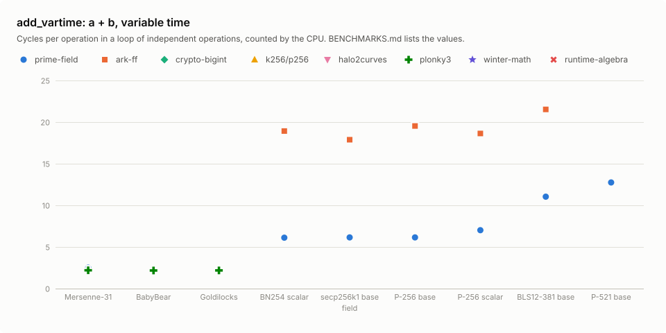

| Field | prime-field | ark-ff | crypto-bigint | k256/p256 | halo2curves | plonky3 | winter-math | runtime-algebra | compile-algebra |
|---:|---:|---:|---:|---:|---:|---:|---:|---:|---:|
| Mersenne-31 | **10.0** | – | – | – | – | **10.0** | – | – | – |
| BabyBear | **11.0** | – | – | – | – | **11.0** | – | – | – |
| Goldilocks | **12.1** | – | – | – | – | **12.1** | – | – | – |
| BN254 scalar | 30.1 | **26.7** | – | – | – | – | – | – | – |
| secp256k1 base | 31.1 | **30.0** | – | – | – | – | – | – | – |
| P-256 base | 31.1 | **29.1** | – | – | – | – | – | – | 1,407 |
| P-256 scalar | 32.1 | **28.2** | – | – | – | – | – | – | 1,386 |
| BLS12-381 base | 48.1 | **34.5** | – | – | – | – | – | – | – |
| P-521 base | **53.1** | – | – | – | – | – | – | – | – |

### add_ct: a + b, constant time

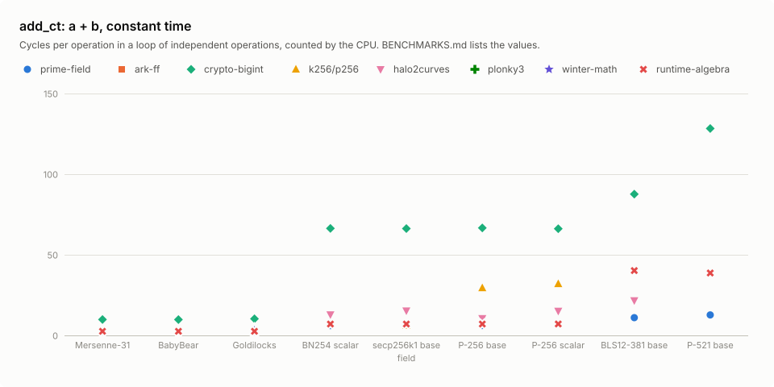

| Field | prime-field | ark-ff | crypto-bigint | k256/p256 | halo2curves | plonky3 | winter-math | runtime-algebra | compile-algebra |
|---:|---:|---:|---:|---:|---:|---:|---:|---:|---:|
| Mersenne-31 | **10.0** | – | 38.1 | – | – | – | – | 16.1 | – |
| BabyBear | **11.0** | – | 38.1 | – | – | – | – | 16.1 | – |
| Goldilocks | **12.1** | – | 39.1 | – | – | – | 16.1 | 16.1 | – |
| BN254 scalar | **30.1** | – | 147 | – | 57.1 | – | – | 36.1 | – |
| secp256k1 base | 31.1 | – | 147 | **11.1** | 58.1 | – | – | 36.1 | – |
| P-256 base | **31.1** | – | 147 | 61.1 | 46.1 | – | – | 36.1 | – |
| P-256 scalar | **32.1** | – | 147 | 87.1 | 61.1 | – | – | 36.1 | – |
| BLS12-381 base | **48.1** | – | 181 | – | 88.1 | – | – | 72.1 | – |
| P-521 base | **53.1** | – | 268 | – | – | – | – | 113 | – |

### sub_vartime: a − b, variable time

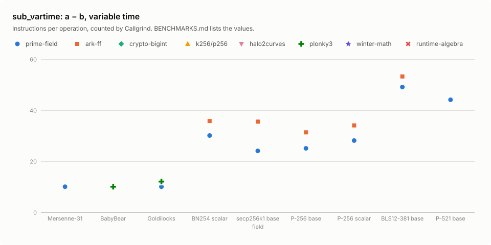

| Field | prime-field | ark-ff | crypto-bigint | k256/p256 | halo2curves | plonky3 | winter-math | runtime-algebra | compile-algebra |
|---:|---:|---:|---:|---:|---:|---:|---:|---:|---:|
| Mersenne-31 | **10.0** | – | – | – | – | – | – | – | – |
| BabyBear | **10.0** | – | – | – | – | **10.0** | – | – | – |
| Goldilocks | **10.1** | – | – | – | – | 12.1 | – | – | – |
| BN254 scalar | **30.1** | 35.8 | – | – | – | – | – | – | – |
| secp256k1 base | **24.1** | 35.5 | – | – | – | – | – | – | – |
| P-256 base | **25.1** | 31.3 | – | – | – | – | – | – | 605 |
| P-256 scalar | **28.1** | 34.1 | – | – | – | – | – | – | 599 |
| BLS12-381 base | **49.1** | 53.2 | – | – | – | – | – | – | – |
| P-521 base | **44.1** | – | – | – | – | – | – | – | – |

### sub_ct: a − b, constant time

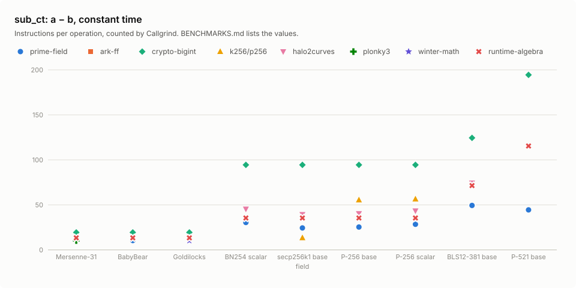

| Field | prime-field | ark-ff | crypto-bigint | k256/p256 | halo2curves | plonky3 | winter-math | runtime-algebra | compile-algebra |
|---:|---:|---:|---:|---:|---:|---:|---:|---:|---:|
| Mersenne-31 | **10.0** | – | 19.1 | – | – | **10.0** | – | 13.1 | – |
| BabyBear | **10.0** | – | 19.1 | – | – | – | – | 13.1 | – |
| Goldilocks | **10.1** | – | 19.1 | – | – | – | **10.1** | 13.1 | – |
| BN254 scalar | **30.1** | – | 94.1 | – | 45.1 | – | – | 35.1 | – |
| secp256k1 base | 24.1 | – | 94.1 | **13.1** | 39.1 | – | – | 35.1 | – |
| P-256 base | **25.1** | – | 94.1 | 55.1 | 40.1 | – | – | 35.1 | – |
| P-256 scalar | **28.1** | – | 94.1 | 56.1 | 43.1 | – | – | 35.1 | – |
| BLS12-381 base | **49.1** | – | 124 | – | 74.1 | – | – | 71.1 | – |
| P-521 base | **44.1** | – | 194 | – | – | – | – | 115 | – |

### mul_vartime: a × b, variable time

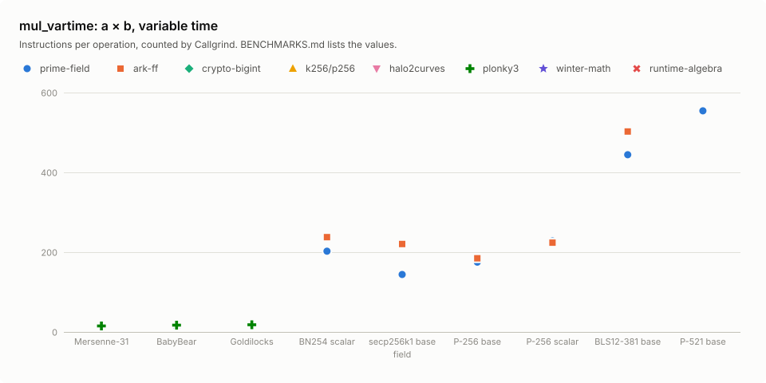

| Field | prime-field | ark-ff | crypto-bigint | k256/p256 | halo2curves | plonky3 | winter-math | runtime-algebra | compile-algebra |
|---:|---:|---:|---:|---:|---:|---:|---:|---:|---:|
| Mersenne-31 | **14.0** | – | – | – | – | 15.0 | – | – | – |
| BabyBear | **13.1** | – | – | – | – | 17.0 | – | – | – |
| Goldilocks | 18.1 | – | – | – | – | **18.1** | – | – | – |
| BN254 scalar | **202** | 238 | – | – | – | – | – | – | – |
| secp256k1 base | **144** | 220 | – | – | – | – | – | – | – |
| P-256 base | **175** | 185 | – | – | – | – | – | – | 2,379 |
| P-256 scalar | 228 | **224** | – | – | – | – | – | – | 2,386 |
| BLS12-381 base | **444** | 502 | – | – | – | – | – | – | – |
| P-521 base | **554** | – | – | – | – | – | – | – | – |

### mul_ct: a × b, constant time

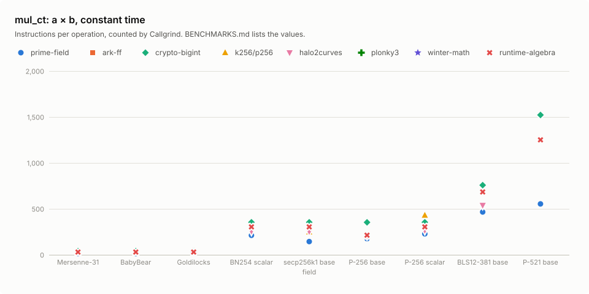

| Field | prime-field | ark-ff | crypto-bigint | k256/p256 | halo2curves | plonky3 | winter-math | runtime-algebra | compile-algebra |
|---:|---:|---:|---:|---:|---:|---:|---:|---:|---:|
| Mersenne-31 | **14.0** | – | 40.1 | – | – | – | – | 30.1 | – |
| BabyBear | **13.1** | – | 40.1 | – | – | – | – | 30.1 | – |
| Goldilocks | **18.1** | – | 44.1 | – | – | – | **18.1** | 30.1 | – |
| BN254 scalar | **212** | – | 354 | – | 257 | – | – | 304 | – |
| secp256k1 base | **144** | – | 354 | 248 | 254 | – | – | 304 | – |
| P-256 base | **175** | – | 353 | 206 | 207 | – | – | 213 | – |
| P-256 scalar | **228** | – | 354 | 430 | 266 | – | – | 304 | – |
| BLS12-381 base | **466** | – | 758 | – | 539 | – | – | 684 | – |
| P-521 base | **554** | – | 1,522 | – | – | – | – | 1,251 | – |

### square_vartime: a², variable time

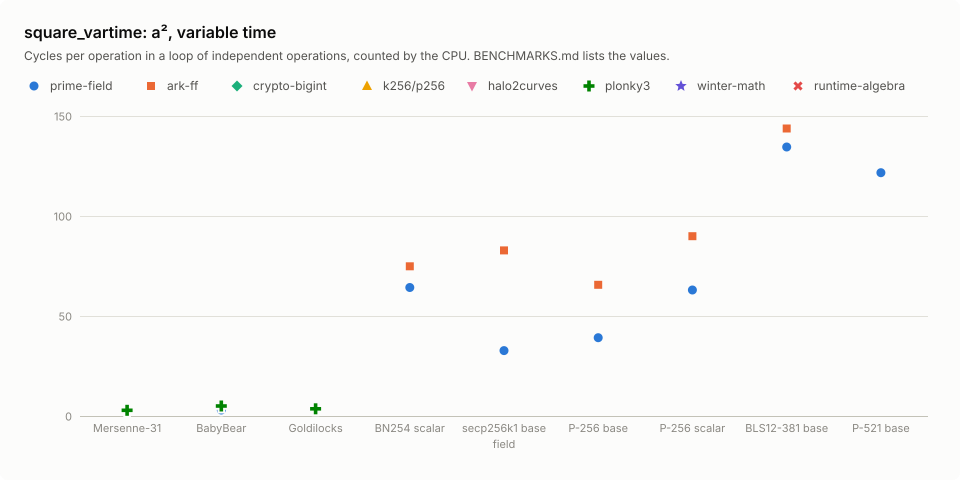

| Field | prime-field | ark-ff | crypto-bigint | k256/p256 | halo2curves | plonky3 | winter-math | runtime-algebra | compile-algebra |
|---:|---:|---:|---:|---:|---:|---:|---:|---:|---:|
| Mersenne-31 | **14.0** | – | – | – | – | **14.0** | – | – | – |
| BabyBear | **13.1** | – | – | – | – | 16.0 | – | – | – |
| Goldilocks | 18.1 | – | – | – | – | **18.1** | – | – | – |
| BN254 scalar | **176** | 192 | – | – | – | – | – | – | – |
| secp256k1 base | **104** | 211 | – | – | – | – | – | – | – |
| P-256 base | **140** | 176 | – | – | – | – | – | – | – |
| P-256 scalar | **187** | 217 | – | – | – | – | – | – | – |
| BLS12-381 base | **383** | 403 | – | – | – | – | – | – | – |
| P-521 base | **365** | – | – | – | – | – | – | – | – |

### square_ct: a², constant time

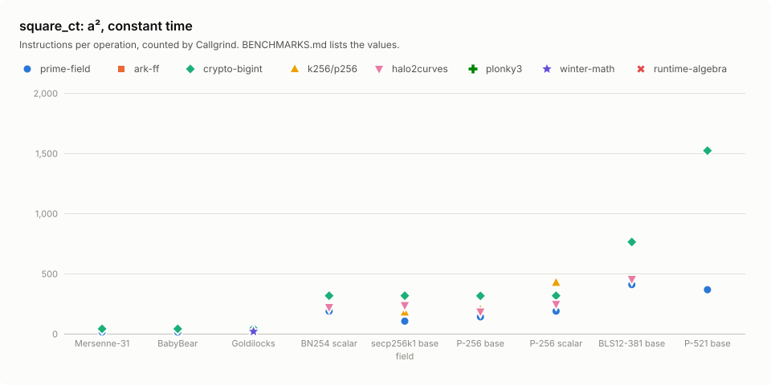

| Field | prime-field | ark-ff | crypto-bigint | k256/p256 | halo2curves | plonky3 | winter-math | runtime-algebra | compile-algebra |
|---:|---:|---:|---:|---:|---:|---:|---:|---:|---:|
| Mersenne-31 | **14.0** | – | 40.1 | – | – | – | – | – | – |
| BabyBear | **13.1** | – | 40.1 | – | – | – | – | – | – |
| Goldilocks | **18.1** | – | 44.1 | – | – | – | **18.1** | – | – |
| BN254 scalar | **187** | – | 315 | – | 220 | – | – | – | – |
| secp256k1 base | **104** | – | 315 | 177 | 236 | – | – | – | – |
| P-256 base | **140** | – | 314 | 201 | 183 | – | – | – | – |
| P-256 scalar | **187** | – | 315 | 424 | 246 | – | – | – | – |
| BLS12-381 base | **408** | – | 762 | – | 453 | – | – | – | – |
| P-521 base | **365** | – | 1,521 | – | – | – | – | – | – |

### invert_vartime: a⁻¹, variable time

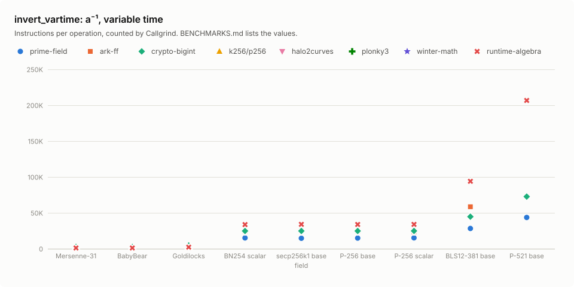

| Field | prime-field | ark-ff | crypto-bigint | k256/p256 | halo2curves | plonky3 | winter-math | runtime-algebra | compile-algebra |
|---:|---:|---:|---:|---:|---:|---:|---:|---:|---:|
| Mersenne-31 | **181** | – | 2,464 | – | – | 556 | – | 988 | – |
| BabyBear | **175** | – | 2,348 | – | – | 553 | – | 982 | – |
| Goldilocks | **515** | – | 4,491 | – | – | 1,201 | – | 1,978 | – |
| BN254 scalar | **14,827** | 25,964 | 24,819 | – | 16,822 | – | – | 29,628 | – |
| secp256k1 base | **14,513** | 27,204 | 24,841 | – | 16,839 | – | – | 29,942 | – |
| P-256 base | **14,150** | 24,535 | 24,817 | – | 16,888 | – | – | 29,709 | 357,487 |
| P-256 scalar | **15,040** | 24,028 | 24,853 | 61,263 | 16,949 | – | – | 29,892 | 357,904 |
| BLS12-381 base | **27,053** | 59,308 | 44,577 | – | 29,179 | – | – | 75,470 | – |
| P-521 base | **44,077** | – | 73,712 | – | – | – | – | 177,377 | – |

### invert_ct: a⁻¹, constant time

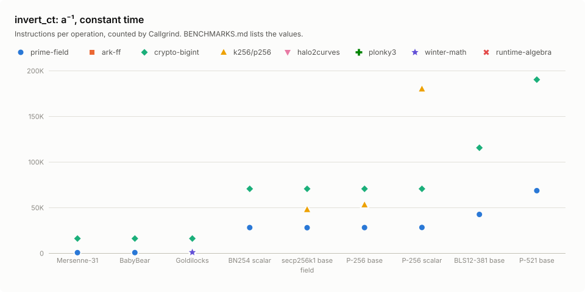

| Field | prime-field | ark-ff | crypto-bigint | k256/p256 | halo2curves | plonky3 | winter-math | runtime-algebra | compile-algebra |
|---:|---:|---:|---:|---:|---:|---:|---:|---:|---:|
| Mersenne-31 | **496** | – | 15,956 | – | – | – | – | – | – |
| BabyBear | **543** | – | 15,956 | – | – | – | – | – | – |
| Goldilocks | 1,081 | – | 15,958 | – | – | – | **825** | – | – |
| BN254 scalar | **27,910** | – | 70,410 | – | – | – | – | – | – |
| secp256k1 base | **27,830** | – | 70,410 | 47,559 | – | – | – | – | – |
| P-256 base | **27,909** | – | 70,409 | 52,761 | – | – | – | – | – |
| P-256 scalar | **28,040** | – | 70,410 | 179,737 | – | – | – | – | – |
| BLS12-381 base | **42,306** | – | 115,421 | – | – | – | – | – | – |
| P-521 base | **68,386** | – | 190,060 | – | – | – | – | – | – |

### sqrt_vartime: √a, variable time

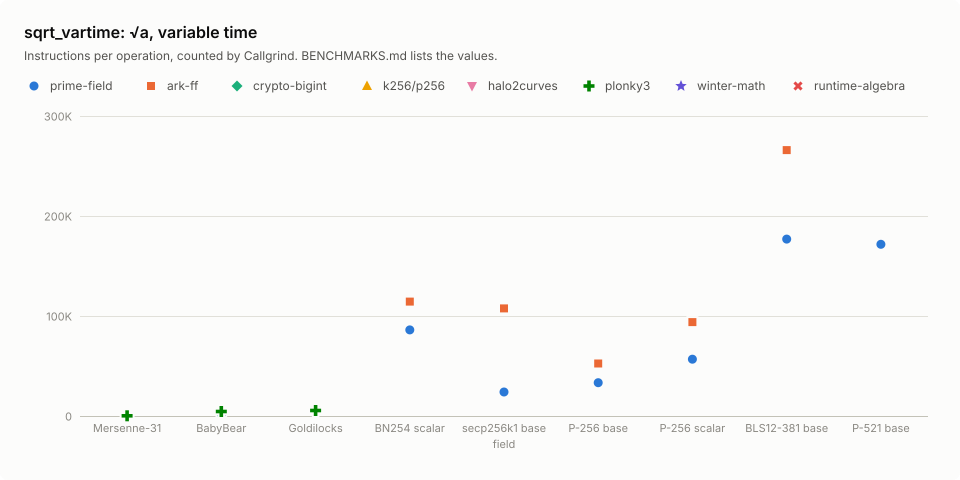

| Field | prime-field | ark-ff | crypto-bigint | k256/p256 | halo2curves | plonky3 | winter-math | runtime-algebra | compile-algebra |
|---:|---:|---:|---:|---:|---:|---:|---:|---:|---:|
| Mersenne-31 | **224** | – | – | – | – | 230 | – | – | – |
| BabyBear | **2,293** | – | – | – | – | 4,537 | – | – | – |
| Goldilocks | 6,695 | – | – | – | – | **5,510** | – | – | – |
| BN254 scalar | **86,058** | 114,439 | – | – | – | – | – | – | – |
| secp256k1 base | **24,034** | 107,603 | – | – | – | – | – | – | – |
| P-256 base | **33,268** | 52,497 | – | – | – | – | – | – | – |
| P-256 scalar | **56,819** | 93,944 | – | – | – | – | – | – | – |
| BLS12-381 base | **176,948** | 265,858 | – | – | – | – | – | – | – |
| P-521 base | **171,685** | – | – | – | – | – | – | – | – |

### sqrt_ct: √a, constant time

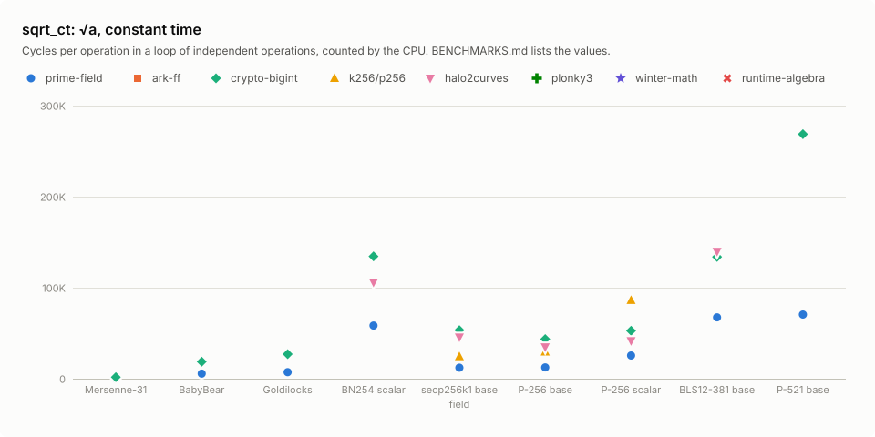

| Field | prime-field | ark-ff | crypto-bigint | k256/p256 | halo2curves | plonky3 | winter-math | runtime-algebra | compile-algebra |
|---:|---:|---:|---:|---:|---:|---:|---:|---:|---:|
| Mersenne-31 | **236** | – | 1,973 | – | – | – | – | – | – |
| BabyBear | **8,097** | – | 33,620 | – | – | – | – | – | – |
| Goldilocks | **15,008** | – | 47,926 | – | – | – | – | – | – |
| BN254 scalar | **153,528** | – | 289,275 | – | 226,321 | – | – | – | – |
| secp256k1 base | **24,101** | – | 123,520 | 46,986 | 116,568 | – | – | – | – |
| P-256 base | **33,273** | – | 104,904 | 51,581 | 90,140 | – | – | – | – |
| P-256 scalar | **59,570** | – | 121,877 | 188,053 | 100,483 | – | – | – | – |
| BLS12-381 base | **187,782** | – | 341,926 | – | 398,850 | – | – | – | – |
| P-521 base | **178,208** | – | 767,496 | – | – | – | – | – | – |

## Reproduce

```sh
cargo run -p prime-field-bench-report -- bench    # Callgrind counts of the native build
cargo run -p prime-field-bench-report -- report   # this file and benchmarks/*.svg
```
